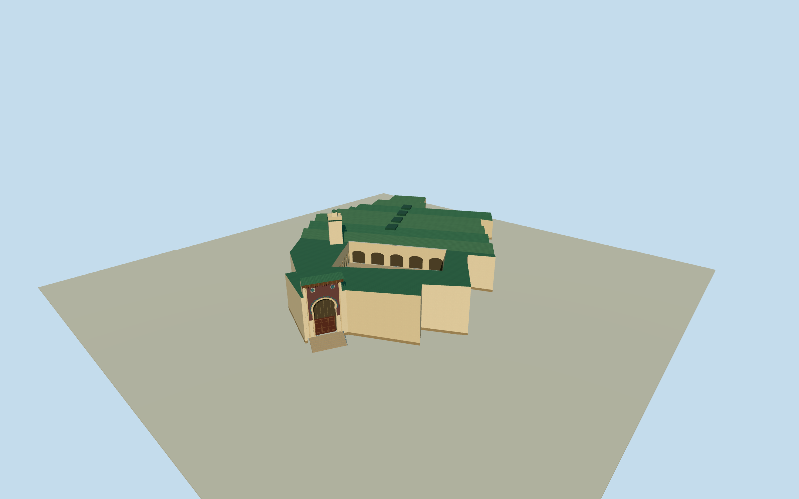

# Mosque of the Andalusians

Mosque of the Andalusians in Fez with an elaborate northern horseshoe portal, green-tiled roofscape, open fountain courtyard and white square minaret.

Authoring state: **review-in-qa.json**. Current completion evidence is in [qa.json](qa.json) and the [completion ledger](../../../../qualla-structures/batches/qualla-003.PROGRESS.md).

- [Mosque of the Andalusians](https://qualla.com/mosque-of-the-andalusians/)

The model represents the exterior appearance documented in April 2016; adjacent buildings and the mosque interior are outside its scope.

The Qualla photograph constrains the portal motif, dark wood gate, and projecting cedar canopy. Original surveyed landform and OpenStreetMap footprint are present, but the location of details within the envelope, terrace and stair heights, and roof profiles are estimates.

The roof models simplified principal bays and the minaret follows the written inventory. Fine mosaic patternwork and carved decoration are suggested by geometry and shared materials.

Build: `node content/worldgen/source/places/ey/eyh/mosque_of_the_andalusians/models/generate-mosque-of-the-andalusians.mjs`. Add `--check` to verify exact regeneration. 2724 triangles; 7 materials; no embedded photographs.
