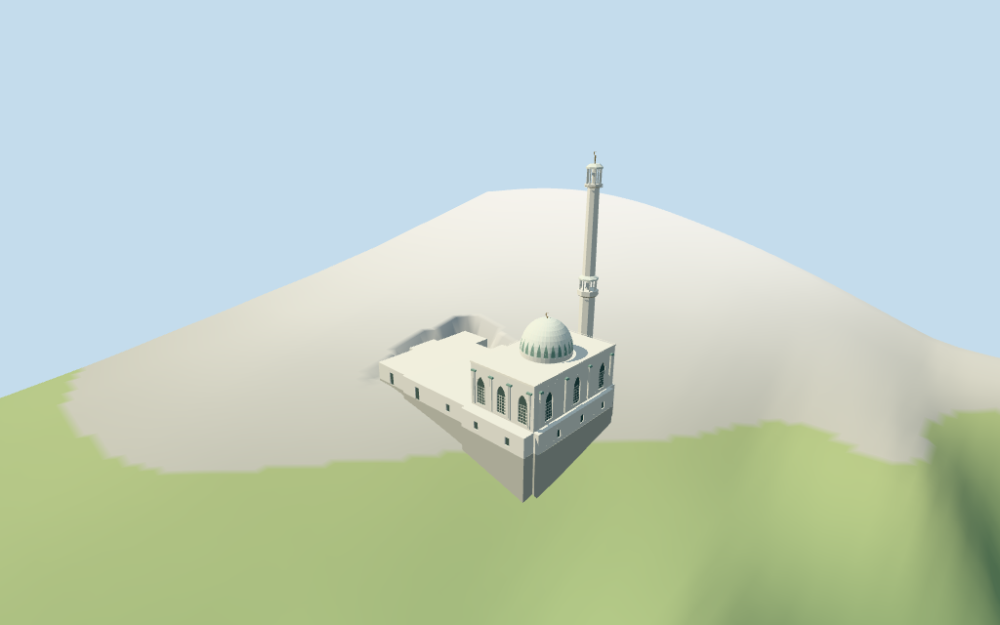

# N0480 — Ibrahim-al-Ibrahim Mosque

Reviewed 2026-10-18 for its declared medium-fi exterior and approximate geographic fit. Heights, internal layout and roof partitions are estimates.

## Exterior and shared materials

Inspected 11 current portable views, including the retained 1024×640 summary. The retained stepped envelope, low white western wing, taller eastern hall, opaque pointed screen fields and doors, slim pilasters with green caps, white ribbed dome with coarse green fields, slender faceted minaret with two gallery sections, open lanterns and bronze crescent finials are present. Pilasters were placed between the screen fields. Fine inscriptions, historic ornament, garden, fencing, street furniture, adjacent buildings and furnished interiors are omitted. The source-terrain view exposes deep footing faces on coarse coastal grade; these are approximate contact geometry, not surveyed retaining walls.

Inspected 11 current shared-material/geographic-flat views, including the placement overlay. Six existing 256² graphs provide lime plaster, raw/coursed limestone, painted metal, ceramic and bronze; seven merged roles include local opaque glazing. Metric UVs and linear tints, no embedded images or unique atlas. Each graph is read once and eviction disposes the model geometry. Precise subtraction uses the current mapped building footprint and retains all 35 neighbors; the model envelope and ground mask use the slightly different retained outline. The flat overlay verifies approximate pose and replacement, not surveyed terrain contact.

## Browser levels

| Level | Triangles | Bytes | Draws |
| --- | ---: | ---: | ---: |
| skyline | 418 | 43940 | 1 |
| district | 1470 | 138548 | 7 |
| street | 3256 | 293768 | 7 |
| closeup | 4532 | 409332 | 7 |

**182,488 bytes for initial skyline plus district**, plus six existing shared 256² graphs. Seven merged roles; no embedded images.

Inspected 27 current medium-fi views: Economy/High, noon/late light, street/block/skyline, silhouette, six details, four matched LODs and four transitions. The stepped white mass, dome and two-gallery minaret remain legible. Skyline keeps the full envelope, coarse dome/green fields, four-post open galleries and simple finial tips. District adds opaque fields, trim and crescent silhouettes. Street restores screen grids, dome ribs and further facets; closeup adds finer ribs/crescents and pilaster details. Whole views retain the tower; some detail cameras intentionally crop it. Context houses are synthetic and the surrounding terrain fixture is illustrative. Physical laptop/phone/tablet and full-city timings remain unmeasured.

## Placement and limits

Retained Q1356809 way/172517450 preserves its reference record,anchor,undirected heading and27-vertex outline. Current ordinary PMTiles supplies a26-vertex main building and a named mosque point sharing id35184544606282. The small northern projection supplies the estimated minaret base;the larger eastern mass supplies the main hall and central dome roles. South-facing facade assignment follows the inspected exterior vocabulary and map arrangement. Internal partitions and signed facade bearing remain visual estimates;the current PMTiles building has no exact Wikidata tag. Standard Protomaps20261014 and Mapzen/USGS viewer extractN0480;datum 44.665883657046464 m. 358 footprint samples span -8.966621027996538 to 6.386138071229894 m;floor 0.33852896270841626 m is the median of 105 outer edge samples plus0.25 m. Footings follow sampled grade. The synthetic review fixture seats the mapped envelope and a3 m margin,leaving surrounding terrain and the Rock to host data. Exact steps,thresholds,retaining levels and engineering are unverified. Independently reproduced all 27 retained outline vertices, 26 current PMTiles building vertices, the named point sharing the building id, unchanged anchor/heading, original tags and empty dimensional facts. The tower base derives from the retained northern projection; hall/dome partitions remain estimates. All 216 placement/host-area checks and 610 FrontSide probes pass for opaque fields, closed roofs, gallery floors/ceilings and clear openings, shaft surfaces, both finials and seated foundations. Standard DEM reproduces 358 footprint samples, 105 edge samples and 511 seated fixture points and the 16-bit heightmap. Finished levels, steps, thresholds and exposed retaining faces are unverified.

Individual Ibrahim-al-Ibrahim Mosque: retained stepped footprint and seated base,a low white wing with opaque doors/windows,taller rectangular prayer hall with pointed screen fields and pilasters,white ribbed dome with original coarse green leaf rhythm,one slender faceted white minaret with two gallery sections,open lanterns and bronze crescent finials. Garden,perimeter fencing,street furniture,adjacent buildings,the Rock,furnished interiors,inscriptions and engineering are excluded. No retained dimensional facts or current selected-building height tags exist. All levels above the local floor are estimates: low wing4.7 m,main hall14.2 m,dome base15.2 m,shell21.9 m plus finial to23 m,and minaret54 m including its finial. The tower has estimated middle and upper gallery/lantern sections. Dome profile,ribs,green fields,pilasters,window/door dimensions and gallery positions are approximations,not surveyed dimensions. Retained exact map identity and the current building/named point support approximate placement. The two inspected 2016/2019 pictures establish the exterior vocabulary. Main hall/dome partitions, signed facade facing, window counts, tower stages, gallery openings, rib/green-field rhythm and vertical dimensions remain visual estimates. No height tags or retained dimensional measurements exist. Low wing4.7 m, hall14.2 m, dome/finial23 m and minaret54 m are declared estimates. Fine current finish, internal layout, precise retaining/ground levels, stairs, threshold joins, interiors, artwork and engineering remain unverified or omitted.

## Verification

49 current views inspected; 610 FrontSide probes; 216 placement/host-area checks; six zero-error/zero-warning Khronos validations. Model/source/input/material/capture/placement hashes agree. Raw map component controls and 16-bit terrain fixture reproduce. Source/placement checks, scene validate/sim30, selected LOD layout and Biome pass. Bulk captures stay ignored.

Source: sha256:54e6760cffe32b3bf0d41ebb1d7845534441f9ba0291f8a179eb4575dbefe8f8

Runtime: sha256:ad5af553d6e52bff6f07e614c6829933ade9a83017ca3db1ac765c57c744418b

Input: sha256:201f3f293c32defc4b8a3314f64709e14e6ff4da3bb20f693ed71235712c4251

Commands: targeted generate-additional-landmarks/import-next-1000-models/generate-landmark-lods/register-landmark-previews --ids=N0480; source/placement --check; capture-next-1000-models --reflections --antialias --fit-shadows; capture-landmark-library --reflections --adaptive-clipping --bounded-placement; capture-medium-fi --ids=n0480_ibrahim_al_ibrahim_mosque --reflections; scene validate/sim30; selected LOD layout; Biome. Existing builds reused.

## Inspected picture references

[Uhooep — 2016-08-20](https://commons.wikimedia.org/wiki/File:Ibrahim-al-Ibrahim_Mosque.jpg). CC-BY-SA-4.0. Inspected960×640 exterior:stepped white lower wing,rectangular upper hall,pointed dark screen fields,pilasters with pale green caps,white dome with raised ribs and green fields,slender faceted white minaret with middle/upper gallery sections,small roofs and bronze crescent finials. The image establishes exterior vocabulary,not measured height or complete current condition.

[Jelger Groeneveld — 2019-09-27](https://commons.wikimedia.org/wiki/File:Ibrahim-al-Ibrahim_Mosque_at_Europa_Point,_Gibraltar.jpg). CC-BY-2.0. Inspected960×720 southern overview:low western wing,taller eastern mosque body,dome and tall offset minaret against the Rock. Windows and lower plinth are visible. The adjacent street,vehicles,perimeter fence,buildings,shore and Rock remain host context.
