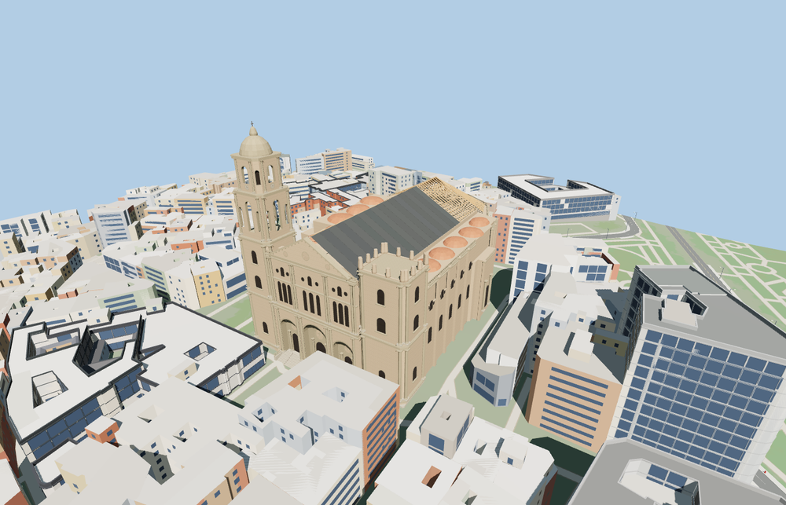

# Málaga Cathedral

The Málaga Cathedral exterior centers on three recessed west portals, the completed pediment and the stepped plaza entrance. The domed north bell tower rises above the unfinished south tower. The east apse and aisle buttresses frame the dark nave roof underlay and exposed timber trusses seen in November 2026.

The 48,110-triangle source rebuilds byte for byte. Skyline, district, street and close-up use 934, 3,194, 15,730, 38,189 triangles. Skyline and district total 386,816 bytes. Six GLBs validated and 36 current views were inspected.

The cathedral replaces its six mapped building records. The Sagrario church, plaza, all 1084 independent buildings and 253 road and path records remain. Seven stair, three roof, two belfry and nine footprint samples passed at each level. The modeled north tower rises 87.0 m above the sampled ground. The original footprint returns when model loading fails.

The exterior depicts the durable fabric visible in November 2026, including the completed west pediment, the timber apse roof framing and the dark protection on the nave. Roof coverage is approximate while the work is ongoing. The scaffold, cranes and eventual finished roof are outside this dated exterior model. Decorative figures, heraldry and clock detail are represented at viewing scale. The cathedral footprint and west facing derive from PMTiles. The bell tower height follows the cathedral chapter’s 87 m figure. Other heights are exterior estimates on standard viewer terrain.

Rebuild with `node packages/worldgen/scripts/generate-malaga-cathedral.mjs`. Append `--check` to compare exact bytes. Use `--ids=cathedral_basilica_of_the_virgin_of_incarnation` for targeted import, LOD, placement and readiness.
