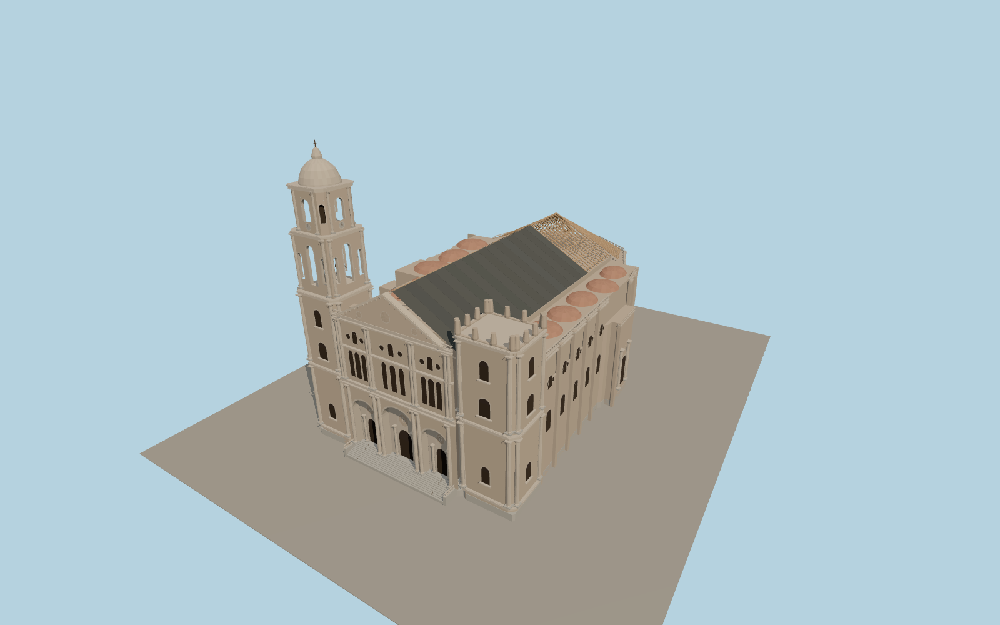

# Málaga Cathedral

The Málaga Cathedral exterior centers on three recessed west portals, the completed pediment and the stepped plaza entrance. The domed north bell tower rises above the unfinished south tower. The east apse and aisle buttresses frame the dark nave roof underlay and exposed timber trusses seen in November 2026.

Run `node packages/worldgen/scripts/generate-malaga-cathedral.mjs` to rebuild the source master. Append `--check` to compare the exact bytes. Use `--ids=cathedral_basilica_of_the_virgin_of_incarnation` for targeted import, LOD generation and placement.

The exterior depicts the durable fabric visible in November 2026, including the completed west pediment, the timber apse roof framing and the dark protection on the nave. Roof coverage is approximate while the work is ongoing.

The scaffold, cranes and eventual finished roof are outside this dated exterior model. Decorative figures, heraldry and clock detail are represented at viewing scale.

The cathedral footprint and west facing derive from PMTiles. The bell tower height follows the cathedral chapter’s 87 m figure. Other heights are exterior estimates on standard viewer terrain.

Original geometry follows the repository license. Map data is © OpenStreetMap contributors under ODbL-1.0 via Protomaps. Terrain samples are described in terrain-grid.json. Ordinary pictures stay local and are not redistributed or used as textures. Current acceptance is recorded in qa.json.
