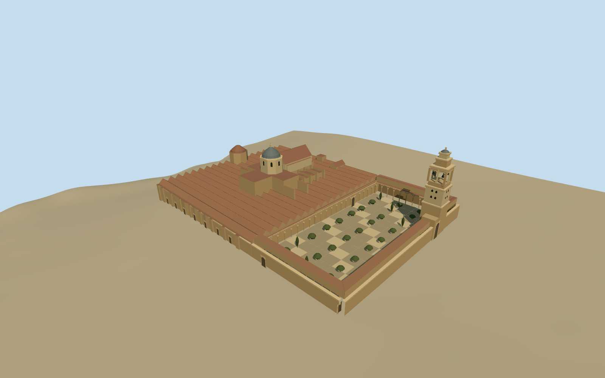

# Mosque–Cathedral of Córdoba

The Mosque–Cathedral of Córdoba with its Orange Court, high bell tower, pale Renaissance crossing and many low terracotta roofs.

Authoring state: **review-in-qa.json**. Current completion evidence is in [qa.json](qa.json) and the [completion ledger](../../../../qualla-structures/batches/qualla-003.PROGRESS.md).

- [Mosque-Cathedral of Cordoba](https://qualla.com/mosque-cathedral-of-cordoba/)

This is a medium-fi exterior of the standing monument. Exact contemporary glazing, reliefs, sculpture, inscriptions, paged roof alterations, furnishings and interiors are outside the modeled detail.

Current map controls roof extents, registered doors and courtyard outline. Rough heights, ridge profiles, smaller annexes, gallery bay interval and cladding tones are approximated.

Historical archival views support surviving historic details. The 54 m official bell-tower height takes precedence over inconsistent map height tags.

Build: `node content/worldgen/source/places/ey/eys/mosque_cathedral_of_cordoba/models/generate-mosque-cathedral-of-cordoba.mjs`. Add `--check` to verify exact regeneration. 14062 triangles; 8 materials; no embedded photographs.
