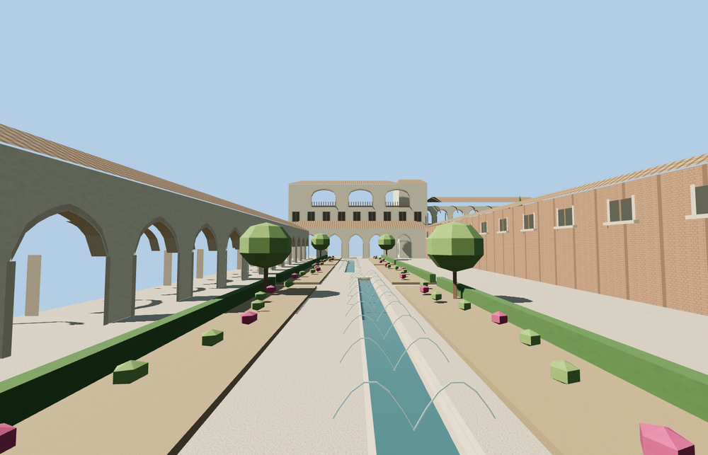

# Generalife

The Generalife is an open hillside ensemble of tile-roofed pavilions, the long Acequia Court and the Cypress Court double arcade. The Water Stairway climbs toward the Mirador Romántico. Formal planted beds, shallow canals and the open-air theatre extend along the lower garden axis.

The 43,566-triangle source rebuilds byte for byte. Skyline, district, street and close-up use 964, 2,840, 15,054, 36,246 triangles. Skyline and district total 362,940 bytes. Six GLBs validated and 36 current views were inspected.

The model replaces three mapped palace buildings and preserves 36 surrounding buildings and 206 transportation records. All four tiers pass checks for seven pools, four terrace levels, five stairway samples, three arcade openings and four outside terrain samples. Ground, water and landcover restore on unload.

The footprint, channel locations and Water Stairway follow standard PMTiles. Flat court elevations, individual arches, seating and retaining walls are photo-based reconstructions fitted to standard viewer terrain. Water channels, fountain arcs and garden planting use static geometry and shared materials. Seasonal planting, temporary stage equipment and private interiors are outside the modeled exterior.

Rebuild with `node packages/worldgen/scripts/generate-generalife.mjs`. Append `--check` to compare exact bytes. Use `--ids=generalife` for targeted import, LOD, placement and readiness.
