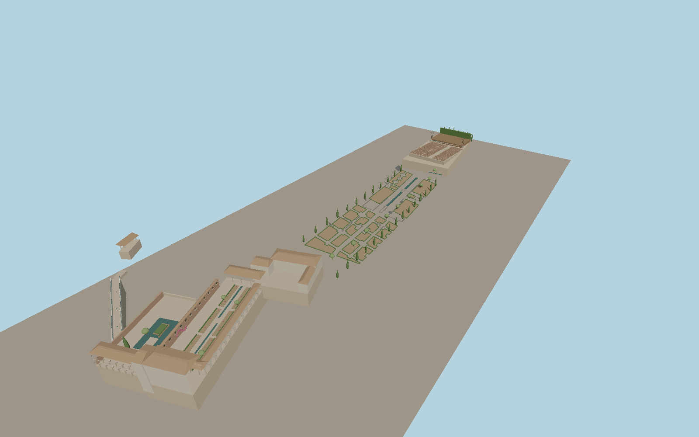

# Generalife

The Generalife is an open hillside ensemble of tile-roofed pavilions, the long Acequia Court and the Cypress Court double arcade. The Water Stairway climbs toward the Mirador Romántico. Formal planted beds, shallow canals and the open-air theatre extend along the lower garden axis.

Run `node packages/worldgen/scripts/generate-generalife.mjs` to rebuild the source master. Append `--check` to compare the exact bytes. Use `--ids=generalife` for targeted import, LOD generation and placement.

The footprint, channel locations and Water Stairway follow standard PMTiles. Flat court elevations, individual arches, seating and retaining walls are photo-based reconstructions fitted to standard viewer terrain.

Water channels, fountain arcs and garden planting use static geometry and shared materials. Seasonal planting, temporary stage equipment and private interiors are outside the modeled exterior.

Original geometry follows the repository license. Map data is © OpenStreetMap contributors under ODbL-1.0 via Protomaps. Terrain samples are described in terrain-grid.json. Ordinary pictures stay local and are not redistributed or used as textures. Current acceptance is recorded in qa.json.
