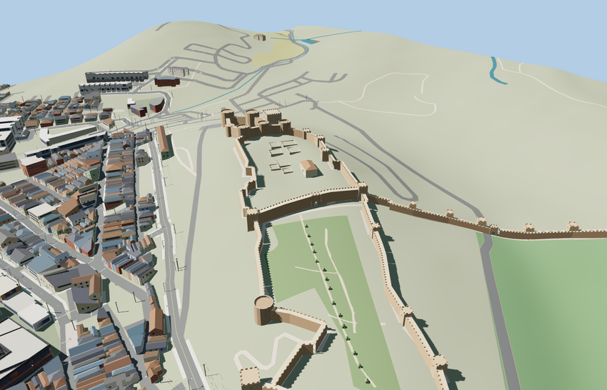
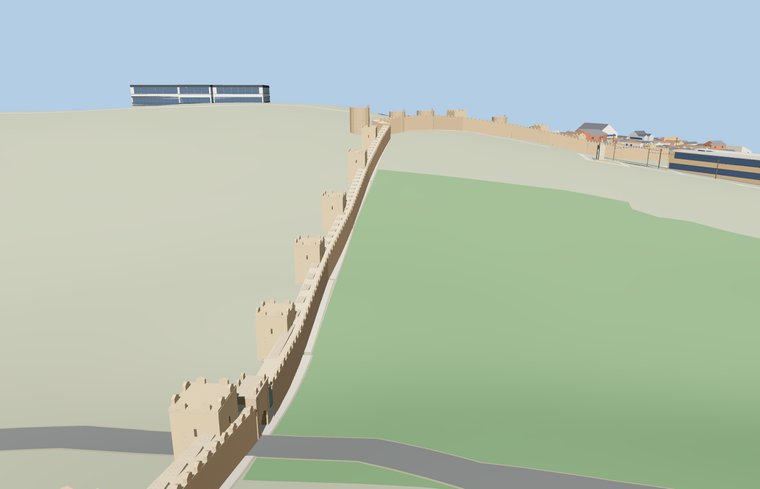

# Alcazaba of Almería and Cerro de San Cristóbal review

Reviewed 2026-11-14. The fortress and hill walls are active in the Almería placement catalog.

The model includes the Christian castle with recessed round bastions and its keep, the archaeological enclosure and Muro de la Vela, the garden enclosure and lower gate, and the Jayrán wall on Cerro de San Cristóbal. The viewer replaces eight mapped building footprints and retains the native pool, 1,865 surrounding buildings and 554 road and path records in the fixture. Three gate openings and the uncovered Christian castle court passed at each detail level. The retaining wall bases follow the sampled terrain.

Six GLBs passed validation. The skyline and district models total about 355 kB. The four levels use five shared material graphs and no embedded images. The review includes 25 viewer captures. [Placement, materials and unload checks](shared-capture-report.json)

The wall heights, archaeological remnants and garden details are photograph-based estimates. The coarse elevation grid smooths some of the scarp beneath the walls. [Museum photographs](https://www.museosdeandalucia.es/web/conjuntomonumentallaalcazabaalmeria)

