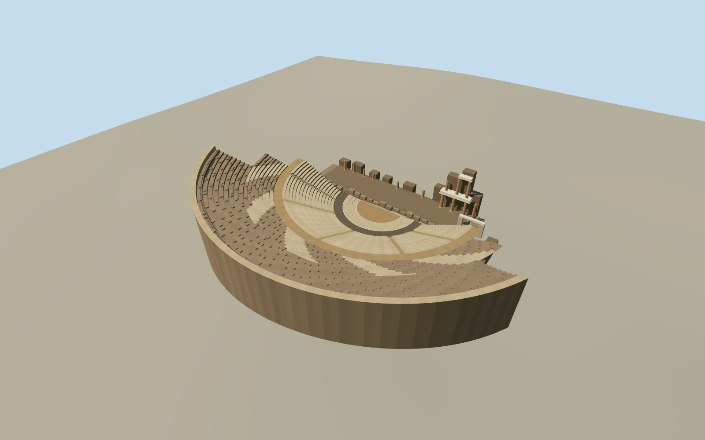

# Roman Theatre of Cartagena

The excavated Roman theatre with a steep limestone cavea, grey orchestra ring, low stage deck and uneven stacks of restored stage columns.

Authoring state: **review-in-qa.json**. Current completion evidence is in [qa.json](qa.json) and the [completion ledger](../../../../qualla-structures/batches/qualla-003.PROGRESS.md).

- [Roman Theatre of Cartagena](https://qualla.com/roman-theatre-cartagena/)

This is the exposed 2017 site. The partly restored stage wall and seating are represented as surviving fabric, with adjacent cathedral and museum outside scope.

The lower seating follows published dimensions. The spacing and surviving heights of the upper terraces, stage ruins and column fragments are visual estimates.

The original relief remains unchanged. Exact excavation and exposed floor heights are unavailable, so the visible archaeology and local embedment are approximate.

Build: `node content/worldgen/source/places/ey/eyx/roman_theatre_cartagena/models/generate-cartagena-theatre.mjs`. Add `--check` to verify exact regeneration. 18036 triangles; 5 materials; no embedded photographs.
