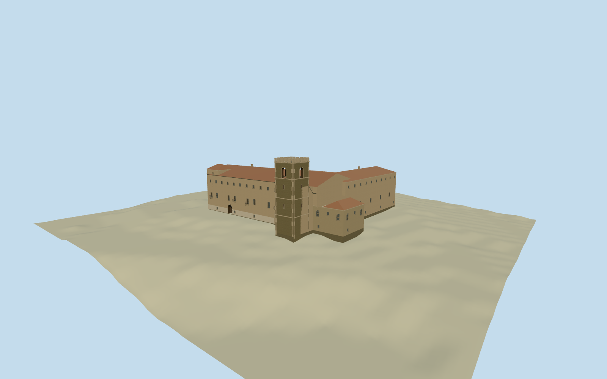

# Monastery of Sant Jeroni de Cotalba

The standing Alfauir monastery and church, with its tall crenellated Gothic belfry and open double-level cloister.

Authoring state: **review-in-qa.json**. Current completion evidence is in [qa.json](qa.json) and the [completion ledger](../../../../qualla-structures/batches/qualla-004.PROGRESS.md).

- [Monastery of Sant Jeroni de Cotalba](https://qualla.com/monastery-of-sant-jeroni-de-cotalba/)

The perimeter, two tower positions, and roof hierarchy are grounded in the mapped and surveyed evidence. Individual roof breaks, opening positions on screened façades and fine carved ornament are representative.

The model covers the attached monastery and church block. The separate aqueduct, gardens, agricultural outbuildings, defensive tower and museum interiors lie beyond its extent.

Build: `node content/worldgen/source/places/ey/eyz/monastery_of_sant_jeroni_de_cotalba/models/generate-monastery-of-sant-jeroni-de-cotalba.mjs`. Add `--check` to verify exact regeneration. 15984 triangles; 6 materials; no embedded photographs.
