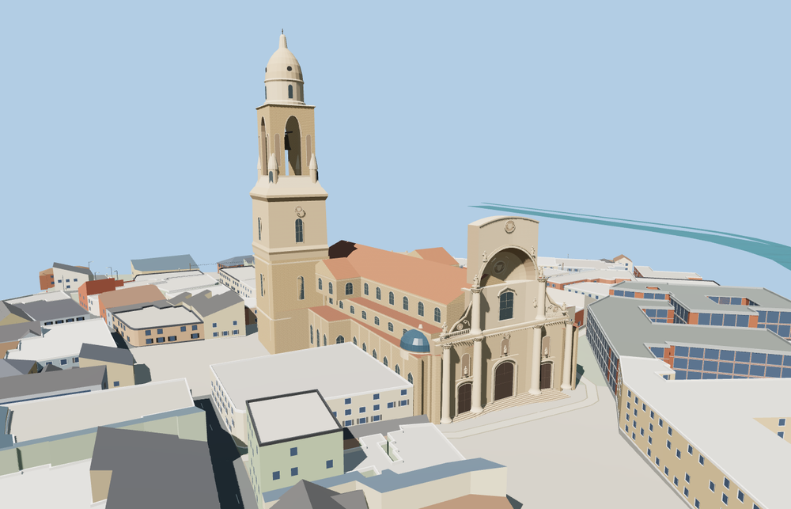

# Murcia Cathedral

Murcia Cathedral with its concave Baroque west screen, three portals, blue side cupolas, tall tiered bell tower, and the faceted Vélez Chapel with its carved chain and shields.

The 36,544-triangle source rebuilds byte for byte. Skyline, district, street and close-up use 971, 3,978, 10,295, 35,362 triangles. The first two tiers total 376,052 bytes. Six GLBs validated and 38 current views were inspected.

Each tier passes 30 foundation, eight stair, three portal, three recess, two bell opening and five chapel-face probes. The first tread is 0.179 m above the sampled plaza grade. The viewer retains 144 independent building records and 75 mapped transportation parts. Failed loading retains the original mapped footprint.

The cathedral outline and tower location follow PMTiles, and the summit follows the reported 95 m height. Ordinary photographs guide the proportions of the west screen, statuary, smaller roof volumes and carved stonework. The modeled portals depict the exterior. The plaza, neighboring buildings, and surrounding terrain retain the native viewer data. Physical-device timings are unmeasured.

Rebuild with `node packages/worldgen/scripts/generate-murcia-cathedral.mjs`. Append `--check` to compare exact bytes. Use `--ids=murcias_cathedral` for targeted import, LOD, placement and readiness.
