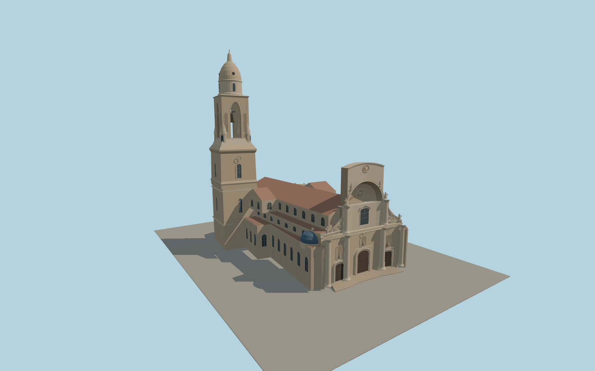

# Murcia Cathedral

Murcia Cathedral with its concave Baroque west screen, three portals, blue side cupolas, tall tiered bell tower, and the faceted Vélez Chapel with its carved chain and shields.

Run `node packages/worldgen/scripts/generate-murcia-cathedral.mjs` to rebuild the source master. Append `--check` to compare the exact bytes. Use `--ids=murcias_cathedral` for targeted import, LOD generation and placement.

The cathedral outline and tower location follow PMTiles, and the summit follows the reported 95 m height. Ordinary photographs guide the proportions of the west screen, statuary, smaller roof volumes and carved stonework.

The modeled portals depict the exterior. The plaza, neighboring buildings, and surrounding terrain retain the native viewer data.

Original geometry follows the repository license. Map data is © OpenStreetMap contributors under ODbL-1.0 via Protomaps. Terrain samples are described in terrain-grid.json. Ordinary pictures stay local and are not redistributed or used as textures. Current acceptance is recorded in qa.json.
