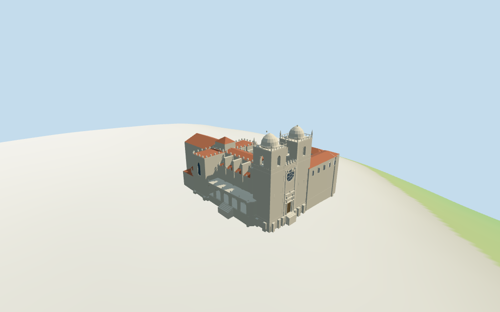

# N0400 — Porto Cathedral review

Reviewed 2026-10-16 against current source/runtime bytes. Accepted for the medium-fi exterior and approximate horizontal placement. Tagged map heights guide the massing; internal stages, openings and exact host-ground joins remain estimates.

## Built result

Inspected all 11 final portable/source-terrain frames, including the 1024x640 summary. Individual Porto Cathedral has granite fortress twin towers, pale faceted domes and corner pinnacles, a west rose with eight visible spokes beneath an archivolt, layered portal/pilasters, a long crenellated nave, buttressed transepts, red-tile choir/crossing roofs, northeast chapel and low north baroque loggia. Immediate mapped cloister/Casa do Cabido ranges surround an open Gothic courtyard. Corrected hidden rose spokes, unsupported cornices, buttress-overlapped clerestory openings, missing distant chapel roof and excessive small finial heights. Exact sculpture, tracery and narrative tile scenes are simplified.

Medium-fi exterior from four actually inspected photographs: pgouvea1 2007 elevated west view, Georges Jansoone2006 west facade, Nuno Tavares2005 north loggia/transept and ho visto nina volare2007 court-facing towers. Standard viewer PMTiles/DEM supply raw plans and tagged part heights. No bespoke surveys or redistributed reference photographs. Individual proportions and selected features are authored; fine portal sculpture, exact rose/cloister tracery, narrative azulejo scenes, full interiors, hidden roof joins, current finish, surveyed ground contact and engineering are excluded, simplified or unverified. Separate bishop palace remains host content.

## Shared surfaces and browser levels

Inspected all 11 final shared/geographic frames. Five existing cached 256-square ashlar, granite, ceramic roof tile, plain wood and glazed tile graphs serve six material groups including local blue-grey glass. Metric UVs, linear tints and flat architectural normals; no embedded images, unique facade photographs or baked lighting. Blue-white loggia panels are generic glazed-tile abstractions, not copies of narrative azulejos. All graphs read once; unload leaves zero live model geometries. Geographic capture uses flat terrain; source preview retains standard DEM.

| Level | Triangles | Bytes | Draws |
| --- | ---: | ---: | ---: |
| skyline | 810 | 80,916 | 1 |
| district | 3,186 | 293,040 | 6 |
| street | 9,659 | 871,208 | 6 |
| closeup | 11,673 | 1,026,048 | 6 |

Initial skyline plus district geometry: **373,956 bytes**. Master **1,404,456 bytes / 11,673 triangles**; runtime **1,403,892 bytes**. Five shared 256² graphs; zero embedded images. Download figure excludes shared graph definitions/runtime texture generation. Separate POSITION/NORMAL streams and equal CPU/GPU reservations.

Inspected all 27 final medium-fi frames: Economy/High, noon/late, street/block/skyline distances, texture-free silhouette, six details, four matched whole LODs and four transitions. Skyline810 triangles retains twin dome-capped towers, the rose/front, long church, low north gallery and open cloister court. District3186 adds shared surfaces, open belfries/loggia, rose spokes, portal and sparse merlons. Street9659 adds clerestory and range recesses, denser crenellations and pointed court openings; closeup/master11673 add selected circular court tracery and refined arches. Distant missing small details are intentional. Portuguese azulejo neighbors are synthetic style fixtures; physical laptop/phone timing remains pending.

## Geographic, height and terrain scope

Exact retained way/210461448 and Q1441255 match current cathedral whole35184582550280 and its same-ID Sé do Porto POI. Preserve the raw whole, mapped architectural parts and immediate cloister/Casa do Cabido ranges. Anchor and heading0.027014727523rad unchanged. +X east toward choir, -X west twin-tower/rose facade, -Z north baroque loggia, +Z south cloister courtyard. No horizontal rescale. Separate southeastern bishop palace and neighboring buildings remain host content.

Retained anchor **[-8.611214702,41.142799644]**, heading **0.027014727523 rad**, approximately 3° facing uncertainty. Current raw cathedral whole **35184582550280**, immediate cloister/Casa do Cabido ranges and mapped parts give **55 controls / 469 raw outline and courtyard points**. Earlier exact whole and tags remain in reference metadata. No horizontal rescale.

Mapped part maxima retained: twin tower bodies31m and caps37m, central crossing26m, choir23m, nave/transept21m, side aisles16m, buttresses20m, north loggia9m, northeast round chapel13m and low north flank9m. Cloister10m, east range13m, west chapter range19m, south ranges17/20/11m. All roof eaves, stage divisions, dome/finial profiles, opening sizes, crenellations, porch steps and carved details are picture estimates within those mapped heights. Floor0.5m above local standard DEM datum; mapped heights are treated above that estimated attachment plane. No independent height/width/length facts.

Estimated architectural divisions include nave eave/ridge19.7/21m, aisle14.7/16m, transept19.7/20m with merlons to21m, choir19.5/23m, crossing23.5/26m, dome transition31..36.2m with central finial37m, west central facade23m plus decorative crenellations, loggia main cornice8.1m/roof9m and small finials9m. Cloister9.1/10m, selected attached ranges have estimated eaves2m below their tagged roof maximum. These are picture-led partitions,not surveyed dimensions.

Standard viewer DEM datum 70.919308m; selected raw perimeter -4.85..2.36m. Floor0.5m and adaptive footings crossY=0. Exact hilltop terraces, square/door/step/base joins, absolute altitude and walking remain unverified. Raw DEM is retained without terrain cutout or flattening.

All **372 viewer-footprint checks** cover selected controls while preserving the courtyard, four nearby host buildings and west/north squares. No terrain cutout, flattening or road replacement. Standard DEM perimeter **−4.85..+2.36 m**, datum **70.919308 m**; exact terraces, entrance treads, door thresholds, base clipping, absolute altitude and walking remain unverified. Regional neighbors are synthetic fixtures,not reconstructed Porto streets.

## Verification

**49 current final frames inspected**:11 portable/source-terrain,11 shared/geographic and27 medium-fi. **258 actual geometry probes** cover selected closed roofs, recessed door/glass, open belfry/loggia/court apertures and the unroofed courtyard. Six Khronos validations have zero errors,warnings and embedded images. Source/import/LOD/input/capture bindings,registered recipe,source inventory/schema,scene validation/30-tick simulation and targeted byte reproduction pass.

Source: `sha256:dcb5d3487564bc675b524402f6d318b8ff8ca876544e16b5c752363993fe4e54`

Runtime: `sha256:3abfdbad13522c9a009897dd4c1e64ea2aef9cb47f8ac9abf40971ce72ad1f68`

Model input: `sha256:8452074ce8edeb9c037db8a522fd3f0b4b59e2a87be4108cc104cb8d5f9d60ad`

Simulation: `sha256:6bd883961ec1731a77b0a030090644e4414751397a5284aa966e354b4f218e9b`

Commands: targeted generate/import/LOD/register-landmark-previews `--ids=N0400`; generate `--check`; portable reflections/antialiasing/fitted shadows; shared reflections/adaptive clipping/bounded placement; medium-fi reflections; scene validate and30-tick simulation. Bulk captures remain ignored. Next full source checkpoint **N0392–N0409**.

## Picture references

[pgouvea1 — 2007-06-11 (Exif)](https://commons.wikimedia.org/wiki/File:PortoView.jpg). CC-BY-2.0. Inspected elevated western city view: two square fortress towers with pale domed caps/finials, tall central rose recess, long buttressed church with crenellated upper edges, red pitched roofs, separate white/red bishop palace to south. Small rear roof masses and ground contact partly hidden; picture is not a measured plan.

[Georges Jansoone — 2006-09-17](https://commons.wikimedia.org/wiki/File:Porto.Cathedral01.jpg). CC-BY-2.5 or CC-BY-SA-3.0/GFDL. Inspected west facade: pale granite ashlar, two heavy square towers with single arched belfry lights, upper balustrades, domed caps and corner pinnacles. Central round rose beneath large recessed archivolt; ornate stacked rectangular portal and paired pilasters. Portal is partly scaffolded. Fine statuary and exact tracery are simplified.

[Nuno Tavares (Commons attribution) — 2005-01-01 (Exif)](https://commons.wikimedia.org/wiki/File:Nt-se_do_porto2.jpg). CC-BY-SA-2.5. Inspected north loggia/transept at night: tall crenellated transept and corner buttresses, low baroque arcade with deep round arches, articulated piers, curved pediment/cornice, decorative finials, blue-white tile panels and frontal stair/balustrade. Lighting is artificial; daylight palette uses other views. Exact painted scenes and staircase elevations are not inferred.

[ho visto nina volare — 2007-10-08](https://commons.wikimedia.org/wiki/File:PortoCathedral1.jpg). CC-BY-SA-2.0. Inspected court-facing view: both square tower backs carry arched lights and pale domed caps, rail parapets and corner pinnacles. Nave side has large buttresses and pointed crenellations. Lower cloister galleries have pointed frames and circular openings with pale stone/blue-white tile surfaces. Court floor and full south/east ranges are cropped.

## Limits

Fine sculpture,exact tracery,narrative tile scenes,complete interiors/bells,hidden joints,current finish,surveyed terrace/stair/base engineering and physical device timing remain simplified,excluded or unverified. The bishop palace and surrounding town are separate host content. This review accepts the stated medium-fi exterior and approximate geographic scope;the1000-candidate project remains incomplete.
