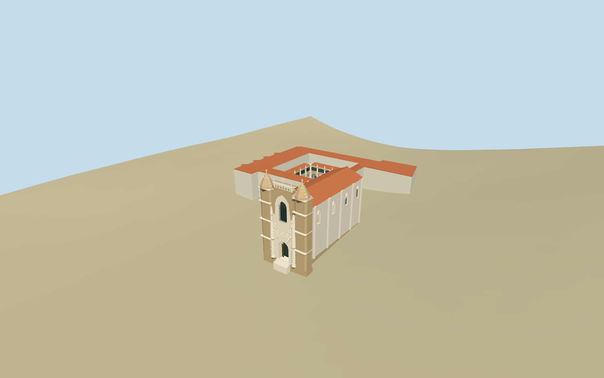

# monastery_of_santa_cruz — Monastery of Santa Cruz

Reviewed 2026-10-19 in one continuous author/build/inspect/fix round.

## Appearance

Inspected48 current source/shared/medium-fi/native/fallback views during one continuous ordinary-picture/map brief, build and correction round. Specific mapped Santa Cruz church with massive stone west screen, twin faceted stepped pinnacles/crosses, pierced central crest, true recessed arched entrance, tall grilled window and raised pale sculptural screen with original simplified figures/niches/scrolls. White nave/tiled roof and mapped monastery wings surround an actual open cloister court with pointed paired arcades, upper glazed register/pinnacles and original tiered fountain. Initial roof polygon closing the court, insufficiently distinct facade screen and adjacent-building clipping were corrected in this round. No copied readable text, narrative tile images or sculpture inventory.

## Shared materials and browser levels

Six existing shared256-square graphs: stone_ashlar for warm masonry, stone_limestone for pale carved trim/fountain, plaster_lime for white ranges, tile_ceramic for terracotta roofs and abstract blue tile band, metal_painted for tinted recessed dark glazing and wood_plain for timber entrance leaves. Seven roles/at most seven draws; each graph read once in the production resolver. Metric UVs/linear tints, no embedded images or unique atlas, separate GPU streams and matching CPU/GPU accounting. Four levels966/3756/11827/11827triangles; initial geometry459,924bytes. Eviction releases all model geometry.

| Level | Triangles | Bytes | Draws |
| --- | ---: | ---: | ---: |
| skyline | 966 | 101516 | 1 |
| district | 3756 | 358408 | 6 |
| street | 11827 | 1172292 | 7 |
| closeup | 11827 | 1172292 | 7 |

Inspected noon/late, economy/high, whole silhouette, west screen, cloister/fountain, open-court overhead view, all four levels and transitions. Skyline retains the facade/pinnacles, nave and open courtyard with sparse post/lintel lower arcade. District adds selected windows, frame mouldings and pointed arcade massing; street/close adds the pale sculptural screen, layered arch bands, simple figures/niches, paired tracery columns, pinnacles and tile bands. Street and closeup use the same bounded geometry because this medium-fi asset needs no additional close-up inventory. Detail crops can cut the tops of crosses/fountain; whole/turntable views carry full silhouette judgment. Flat shared stages expose terrain-relative bases. Green native fixture ground, surrounding facades and paths are host context rather than exact court/plaza paving.

## Approximate map fit

Named standard PMTiles church building/POI35184576280912 and monastery building/POI52776561095808 correlate two actual mapped controls and the court hole. Named monastery relation2962560 is identified; no exact-QID footprint claim. Anchor-8.428761,40.210945; heading0, internal angle-.154600686944rad, west entrance local-x. All2703 independent in-tile building records, including Town Hall35184576280911 and Cafe Santa Cruz35184595417581, remain byte-equivalent. A2cm control-mask pad subtracts independent footprints plus1mm protection. Overlapping original authored-map fragments4.855377m²/church and.326032m²/monastery are retained entirely within protected independent envelopes plus1.1mm numerical tolerance; outside-protected area0. Loaded levels2705 native records comprise2703 independents and these two protected fragments; failed load2705 full originals. Original6m ground/native water245800.603275m² unchanged. Local buried footings and short entrance steps; no broad slab, flattening or ground/water cutout. Unload releases geometry.

## Limits

Accepted medium-fi standing church and mapped monastery/cloister from four inspected ordinary front/court/passage pictures and standard PMTiles/Mapzen. The cropped night facade and passage image each left a concrete silhouette/roof-arcade coverage gap, filled with the complete2026 front and2019 court views. Heights, rear ranges/roof subdivisions, bay counts, ornament, fountain proportions, grille inventory, weathering and exact thresholds are explicit visualization approximations; no survey or bespoke archive campaign. Shared regular masonry and abstract ceramic band approximate the material vocabulary. No full ritual interior or copied text/narrative tile/stone inventory. Town Hall, cafe, plaza fountain, separate Manga monument, independent buildings and native court/plaza ground remain host context. Coarse urban DEM cannot resolve paved floors/stairs or absolute architectural elevations. Physical-device/dense-city timings remain pending.

## Selected checks

Six Khronos files: zero errors/warnings.398 actual mesh/map-envelope probes; 48 current inspected views. Scene validation/sim30 and strict selected medium-fi audit pass. Source and runtime hashes/material bindings/LOD caps verified.

Rebuild: node packages/worldgen/scripts/generate-additional-landmarks.mjs --ids=monastery_of_santa_cruz; node packages/worldgen/scripts/import-structure-models.mjs --ids=monastery_of_santa_cruz; node packages/tooling/scripts/generate-landmark-lods.mjs --ids=monastery_of_santa_cruz --force.

Source: sha256:720d2b24252d60f142d46afdf9ebd1a3bf2cb9fdc4c5346aac3ff3dd0f145709

Runtime: sha256:bebdc6c810624f74a8550967f80f6cc5782af421ae1544510416531c66a88e81

Input: sha256:07a1958502cedc640badc94fa970f398f9ccd82e004d2e14547747833539e023

## Viewed ordinary pictures

https://commons.wikimedia.org/wiki/File:Façade_of_Santa_Cruz_Monastery_in_Coimbra_2026.jpg — ほっきー; CC0-1.0. Viewed only; no pixels copied.

https://commons.wikimedia.org/wiki/File:Monasterio_de_Santa_Cruz,_Coimbra._Fachada.jpg — José Luis Filpo Cabana; CC-BY-3.0. Viewed only; no pixels copied.

https://commons.wikimedia.org/wiki/File:Cloister_of_Silence,_Coimbra,_Portugal.JPG — (WT-shared) Shoestring; CC-BY-SA-4.0. Viewed only; no pixels copied.

https://commons.wikimedia.org/wiki/File:Cloisters_-_Mosteiro_de_Santa_Cruz_-_Coimbra,_Portugal_-_DSC09697.jpg — Daderot; CC0-1.0. Viewed only; no pixels copied.
