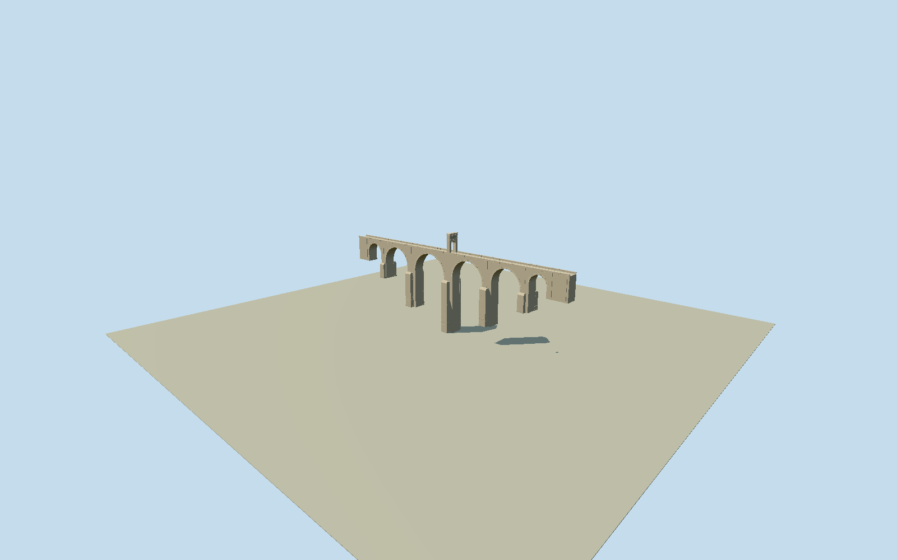

# Alcántara Bridge

Whole surviving Roman bridge across the Tagus at Alcántara, Cáceres: all six unequal round through-vaults, five tall piers with native rectangular/pointed cutwater projections and stepped base ledges, both abutments/approach-wing masonry, narrow paved stone deck and solid parapets, intrinsic central triumphal gateway with an open arched road passage, cornices/attic and bounded inscription-panel recesses. Exclude the separate Roman temple outside the bridge footprint on the southeast approach, Torre del Oro/town walls, downstream modern viaduct/dam, natural river/water/bedrock/hills/trees and whole valley/approach road slabs. This is the whole bridge and its attached honorific arch, not a complete model of every building in the surrounding monument complex. Build closed real through-vault geometry for all6semicircular spans, five connected tall piers and mapped front/back lower rectangular/triangular cutwaters, original approach abutments, continuous narrow paved roadway/solid parapets and central passage gateway, layered cornices/attic and bounded recessed inscription panels. Keep six arch voids and gateway passage truly open at everyLOD; no opaque rectangle behind arches.71moverall maximum includes14mabove-deck honorific gate; approx57mmaximum hidden foundation/deck drop is an explicit text-derived estimate, not measured river bed. One public-domain source photo controls permanent masonry; unseen rear/course count/inscription panels/current fine repairs bounded. Freeze independent512m129²field at fixed southeast approach before geometry; do not fit field to bridge or fabricate water/hills/whole river-valley slab. Separate temple/castle/modernviaduct excluded and not claimed built.

Authoring state: **review-in-qa.json**. Current completion evidence is in [qa.json](qa.json) and the [completion ledger](../../../../qualla-structures/batches/qualla-002.PROGRESS.md).

- [Alcantara Bridge](https://qualla.com/alcantara-bridge/)

Native Q996197 bridge1275882833 has original63-point physical perimeter, distinct from two-node pedestrian road29421412 and downstream modern viaduct941353697/941353698. Fixed anchor at native crossing-axis midpoint, +X southeast toward town/+Z southwest, heading along original NW-to-SE road before terrain/geometry. Native191.965mcrossing axis agrees approximately with authority194mlength; official8moverallwidth controls the body, not an extrusion of lower projecting cutwaters as a giant deck. Six span intervals derived from adjacent native pier/abutment shoulders, five explicit rectangular/pointed front/back cutwaters retained in place. Native contour is coarse aggregate plan, not a measured arch/stone/foundation-height survey; body levels/span radii/uncertain low foundations and fine masonry estimated from the exact whole bridge photo and primary text.

Geometry uses bed-relativeY0 and57mdeck/71moverall including14mgate, derived from municipal structural dimensions. Fixed preselected104mSEaxis sample yields134.0421mcoarse provider height, not a surveyed upper-road approach. Original sample point/field retained unchanged; no ground fitting or corrected survey claim. Actual road/abutment/river-floor agreement unresolved.

Whole bridge with all6unequal through-vaults/five main piers/front and back native lower projections/both end abutments,8mbody and continuous stone deck/solid parapets, central honorific gateway/open roadway/upper attic/cornices/tablet recesses. Original63point contour retained as coarse lower physical plan reference; not extruded into an overwide solid deck. Native shoulder-derived arch intervals and body/cutwater heights/hidden low foundations are approximate, not a precise Roman survey. Separate temple80366887outside bridge footprint, Torre delOro/townwalls and modern viaduct/dam are not built or silently counted.

Municipal194mlength/8mwidth/71mheight INCLUDING approx14mabove-deck gateway. Native axis191.965m retained rather than rescaled. Bed-relative geometry has deck57m/top71m/deepest footing0m; five footing/wing levels and cutwater head/profile from broad source-photo proportions, not verified geology or modern water/foundation survey.6semicircular arcs remain real openings at all detail levels, skyline curve faceting bounded1.8m; smaller stone joints/pilasters/coarse courses simplify at distance.

Exact Qualla-published1830x1261JeanLaurent photo/circa1870nativePD-old record/BNEitem/named1816–1886creator lifespan/nativeSHA1 bound, plus official municipal current structural text. No local media/category edits; omitted rights category recovered by strict new native library proof with64focused provenance regression tests. Primary BNEcatalog bibliography corroborates original photo identity; no protected catalog image pixels. Old1811templecrop competingCCBY4.0unused/no pixels viewed; unrelatedLaurent1864Toledobridge rejected. No questionable source pixels/photo textures or generated bitmaps.

Neutral gray-buff granite palette is not copied from sepia toning. Shared granite/course appearance with raw low-frequency trim texture for modeled ring stones; no unique photographic material. Current repair patches/inscription text/royal relief/stone census are not reproduced, bounded shallow tablets and simple cornices retain permanent structure.

Independent512m129²16641values/four rawTerrariumtiles frozen before geometry unchanged.134.0421mprovider sample at fixed SEaxispoint is a coarse gorge-level proxy, not an architectural road threshold; source field123.64..226.64m/3.67moutput pixel spacing may oversample a much coarser native DEM. Actual bank/road/riverbed contact and live host elevation agreement are unverified. Flat portable/shared/context fixtures show bridge geometry only; no valley/water/hill mesh or fitted/flattened/reacquired field. Geographic preview/replaceFootprint=false.

Build: `node packages/worldgen/scripts/generate-authored-places.mjs --ids=alcantara_bridge`. Add `--check` to verify exact regeneration. 19650 triangles; 4 materials; no embedded photographs.
