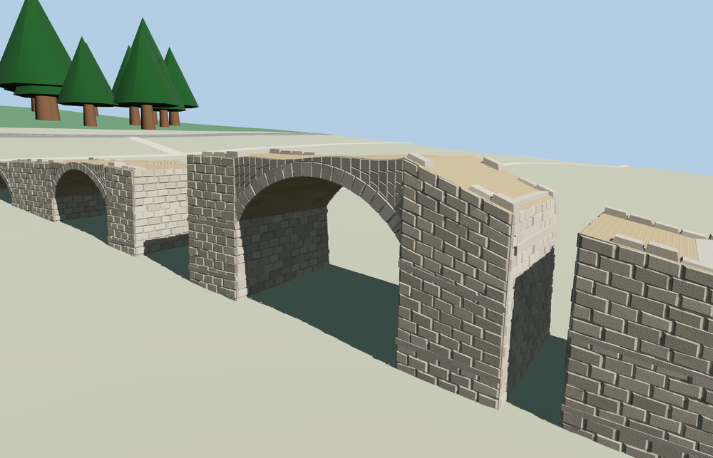

# Alconétar Bridge

Three open segmental barrel vaults descend from the retained masonry ramp to the tall broken arch. The surviving piers retain battered sides, projecting stone courses, interrupted deck edges, and separate blocks near the reservoir.

The main ruins follow the signed OSM footprint and named PMTiles point. The second PMTiles ruin point locates the detached masonry farther southeast. All eight masonry foundation probes meet the sampled site. The southeastern footing continues under the native shoreline to account for the gap between the sampled terrain and rendered reservoir surface. The native shoreline, terrain and all 9 transportation records remain in the fixture through load, unload and failed-load checks.

The 43,758-triangle source rebuilds byte for byte. The first two runtime tiers total 94,752 bytes. Six GLBs validated and 36 current views were inspected.

The surviving masonry is modeled at the relocated site. The matched OSM footprint gives the signed axis, and the second PMTiles ruin point locates the detached remains. The photos control the order of the three visible openings, broken deck and short piers. Local heights, individual stone sizes and the detached masonry outline are exterior estimates. The host reservoir surface can reach the lowest detached masonry as shoreline and water level change.

Rebuild with `node packages/worldgen/scripts/generate-alconetar-bridge.mjs`. Append `--check` to compare exact bytes. Use `--ids=alconetar_bridge` for targeted import, LOD, placement and readiness.
