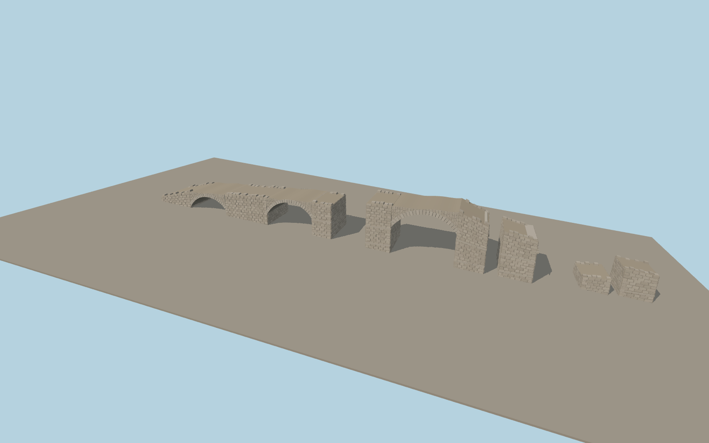

# Alconétar Bridge

Three open segmental barrel vaults descend from the retained masonry ramp to the tall broken arch. The surviving piers retain battered sides, projecting stone courses, interrupted deck edges, and separate blocks near the reservoir.

Run `node packages/worldgen/scripts/generate-alconetar-bridge.mjs` to rebuild the source master. Append `--check` to compare the exact bytes. Use `--ids=alconetar_bridge` for targeted import, LOD generation and placement.

The surviving masonry is modeled at the relocated site. The matched OSM footprint gives the signed axis, and the second PMTiles ruin point locates the detached remains.

The photos control the order of the three visible openings, broken deck and short piers. Local heights, individual stone sizes and the detached masonry outline are exterior estimates.

The host reservoir surface can reach the lowest detached masonry as shoreline and water level change.

Original geometry follows the repository license. Map data is © OpenStreetMap contributors under ODbL-1.0 via Protomaps. Terrain samples are described in terrain-grid.json. Ordinary pictures stay local and are not redistributed or used as textures. Current acceptance is recorded in qa.json.
