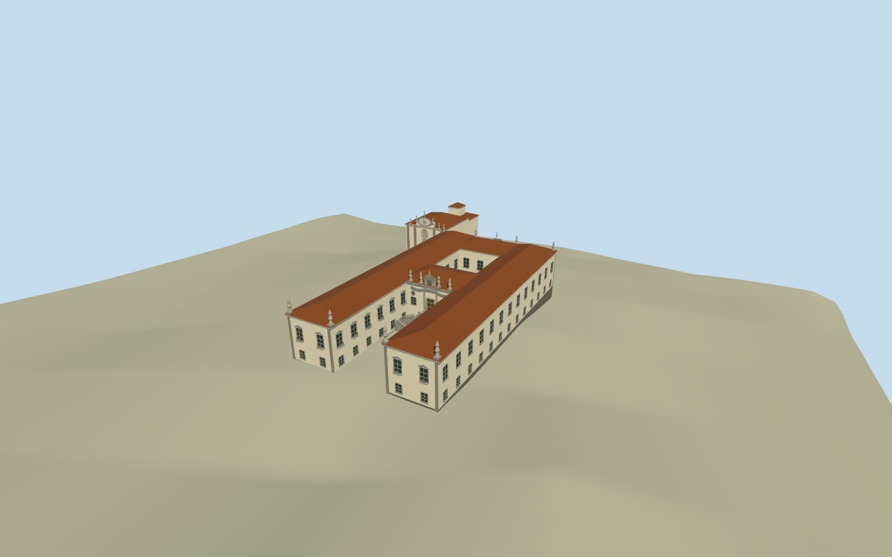

# Mateus Palace

Mateus Palace in Vila Real, with a U-shaped Baroque arrival court, two stone stairs, tiled roofs and the adjoining Nossa Senhora dos Prazeres Chapel.

Authoring state: **review-in-qa.json**. Current completion evidence is in [qa.json](qa.json) and the [completion ledger](../../../../qualla-structures/batches/qualla-004.PROGRESS.md).

- [Mateus Palace](https://qualla.com/mateus-palace/)

Draft exterior: approximate photographic proportions and simplified ornament. It is not a survey, photogrammetric reconstruction or approved current geographic replacement.

Verified CC0 photos specify the granite-trimmed white exterior, tile roofs, entrance steps, split stone pediments, finials, rear fenestration and carved chapel facade.

Terrain sampling/contact, geographic alignment and site activation remain pending. Runtime LODs are produced by the registered after-import pipeline and require visual review.

Reference photos remain in the local Qualla corpus; only provenance, paths and hashes are retained here.

Build: `node content/worldgen/source/places/ez/ez6/mateus_palace/models/generate-mateus-palace.mjs`. Add `--check` to verify exact regeneration. 18009 triangles; 4 materials; no embedded photographs.
