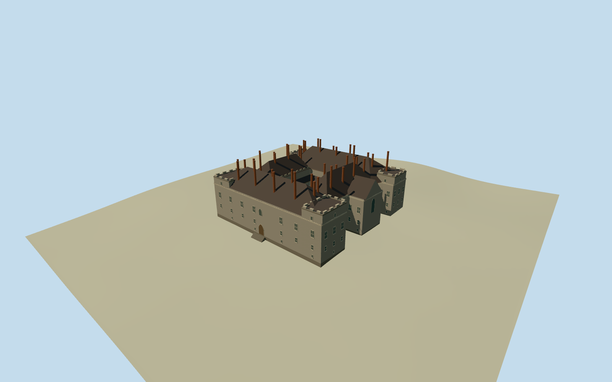

# Palace of the Dukes of Braganza

The rebuilt granite ducal palace at Guimarães, with four wings, a two-storey courtyard cloister, steep roofs and 39 red brick chimney shafts.

Authoring state: **review-in-qa.json**. Current completion evidence is in [qa.json](qa.json) and the [completion ledger](../../../../qualla-structures/batches/qualla-004.PROGRESS.md).

- [Palace of the Dukes of Braganza](https://qualla.com/palace-of-the-dukes-of-braganza/)

The footprint and court are tied to the named map geometry. Roof ridges, tower heights, the arrangement of minor openings and the positions of chimneys outside the photographed court view are estimated.

The four wings, chapel projection, two-level courtyard galleries, and cylindrical brick chimneys are modeled externally. Interior collections, ornaments and the adjacent castle are outside scope.

Build: `node content/worldgen/source/places/ez/ez6/palace_of_the_dukes_of_braganza/models/generate-palace-of-the-dukes-of-braganza.mjs`. Add `--check` to verify exact regeneration. 16761 triangles; 8 materials; no embedded photographs.
