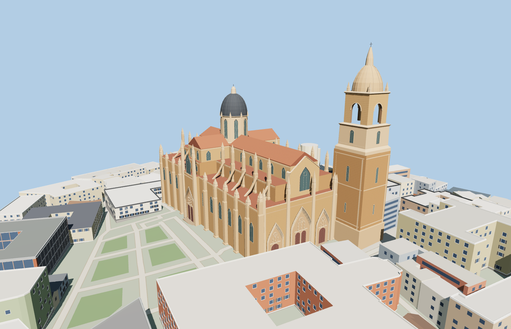

# Salamanca New Cathedral

Salamanca New Cathedral with its golden sandstone, elaborate west portals, side buttresses and pinnacles, lead-colored crossing dome, and taller tiered bell tower.

The 48,734-triangle source rebuilds byte for byte. Skyline, district, street and close-up use 976, 3,555, 15,744, 44,746 triangles. The first two tiers total 351,080 bytes. Six GLBs validated and 38 current views were inspected.

Every tier passes 16 foundation, nine stair, four portal and two open belfry probes. The Old Cathedral retains its native geometry. The viewer retains 197 independent building records and 138 mapped transportation parts. Failed loading retains the original mapped footprint.

The site outline, tower tiers and crossing volumes follow PMTiles. Photographs guide the exterior proportions, ornament, roofs and modeled steps. The west and north doors depict the exterior. The adjoining Old Cathedral, hillside and approaches retain their native viewer geometry. Physical-device timings are unmeasured.

Rebuild with `node packages/worldgen/scripts/generate-salamanca-new-cathedral.mjs`. Append `--check` to compare exact bytes. Use `--ids=salamanca_new_cathedral` for targeted import, LOD, placement and readiness.
