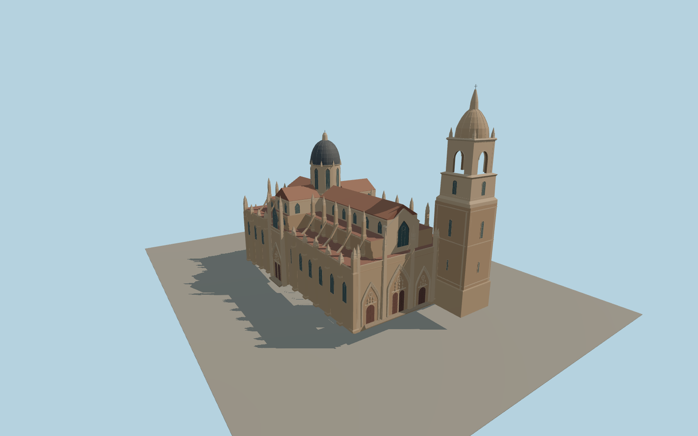

# Salamanca New Cathedral

Salamanca New Cathedral with its golden sandstone, elaborate west portals, side buttresses and pinnacles, lead-colored crossing dome, and taller tiered bell tower.

Run `node packages/worldgen/scripts/generate-salamanca-new-cathedral.mjs` to rebuild the source master. Append `--check` to compare the exact bytes. Use `--ids=salamanca_new_cathedral` for targeted import, LOD generation and placement.

The site outline, tower tiers and crossing volumes follow PMTiles. Photographs guide the exterior proportions, ornament, roofs and modeled steps.

The west and north doors depict the exterior. The adjoining Old Cathedral, hillside and approaches retain their native viewer geometry.

Original geometry follows the repository license. Map data is © OpenStreetMap contributors under ODbL-1.0 via Protomaps. Terrain samples are described in terrain-grid.json. Ordinary pictures stay local and are not redistributed or used as textures. Current acceptance is recorded in qa.json.
