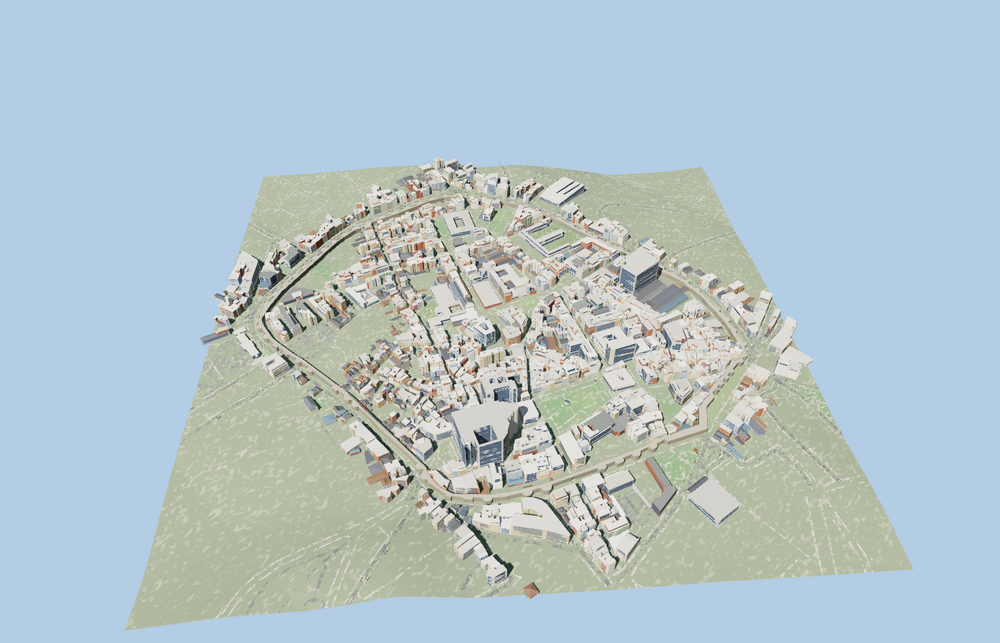

# Roman Walls of Lugo

The complete mapped Roman wall circuit around Lugo, rounded towers, ten open gateways, sloping rampart walk, stone parapets and the Santiago gate shrine.

The 12,706-triangle source rebuilds byte for byte. Skyline, district, street and close-up use 926, 3,542, 10,726, 12,306 triangles. The first two tiers total 388,128 bytes. Six GLBs validated and 38 current views were inspected.

All four tiers pass 30 crossing probes through the ten gates. Minimum sampled headroom is 3.67 m. The fixture retains 4224 independent buildings and 573 mapped road parts. The two native wall features return on failed loading. The rampart and sampled stair remain open, and the native terrain and historic center stay in place.

Deck grades and arch dimensions are reconstructed from the mapped circuit, available terrain and exterior views. The station stair is fitted on the town side of its mapped path. The two wall outlines and mapped passages establish placement. Individual masonry repairs and other stair flights are outside the model scope. Physical-device timings are unmeasured.

Rebuild with `node packages/worldgen/scripts/generate-roman-walls-of-lugo.mjs`. Append `--check` to compare exact bytes. Use `--ids=roman_walls_of_lugo` for targeted import, LOD, placement and readiness.
