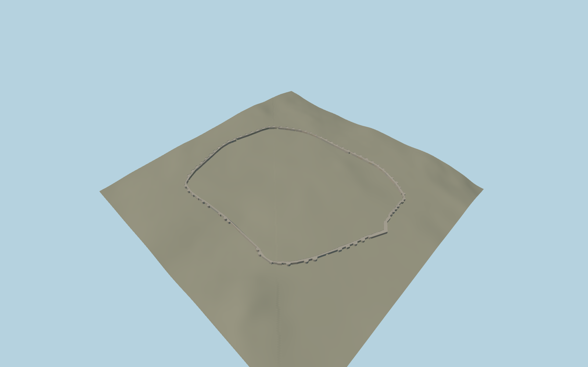

# Roman Walls of Lugo

The complete mapped Roman wall circuit around Lugo, rounded towers, ten open gateways, sloping rampart walk, stone parapets and the Santiago gate shrine.

Run `node packages/worldgen/scripts/generate-roman-walls-of-lugo.mjs` to rebuild the source master. Append `--check` to compare the exact bytes. Use `--ids=roman_walls_of_lugo` for targeted import, LOD generation and placement.

Deck grades and arch dimensions are reconstructed from the mapped circuit, available terrain and exterior views. The station stair is fitted on the town side of its mapped path.

The two wall outlines and mapped passages establish placement. Individual masonry repairs and other stair flights are outside the model scope.

Original geometry follows the repository license. Map data is © OpenStreetMap contributors under ODbL-1.0 via Protomaps. Terrain samples are described in terrain-grid.json. Ordinary pictures stay local and are not redistributed or used as textures. Current acceptance:qa.json.
