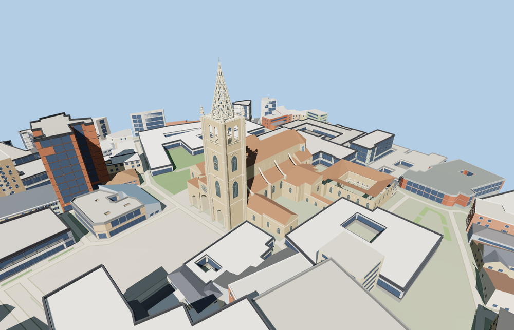

# Oviedo Cathedral

Oviedo Cathedral presents three recessed pointed portals and a rose window to the west plaza. The single southern tower rises to a perforated Gothic spire. A tiled nave, chapels and the Cámara Santa exterior connect to the open Museo Catedralicio cloister.

The 27,688-triangle source rebuilds byte for byte. Skyline, district, street and close-up use 996, 3,583, 12,836, 23,104 triangles. Skyline and district total 428,992 bytes. Six GLBs validated and 36 current views were inspected.

The model replaces three mapped cathedral and cloister features and preserves 160 surrounding buildings and 71 transportation records. All four tiers pass checks for the three porch openings and landings, belfry opening, spire height, nave and chapel ridges, and four cloister arcade openings. The original mapped buildings return if loading fails.

The cathedral, single tower and connected museum cloister use mapped building outlines. Smaller roofs and facade ornament are exterior photo reconstructions. The portico is open to the recessed doors. The model depicts the Cámara Santa exterior and the cloister arcade. Interior rooms, relics and carved figures use exterior viewing scale or are outside the model scope.

Rebuild with `node packages/worldgen/scripts/generate-oviedo-cathedral.mjs`. Append `--check` to compare exact bytes. Use `--ids=metropolitan_cathedral_basilica_of_the_holy_saviour_oviedo` for targeted import, LOD, placement and readiness.
