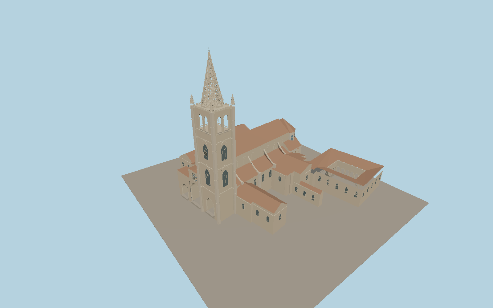

# Oviedo Cathedral

Oviedo Cathedral presents three recessed pointed portals and a rose window to the west plaza. The single southern tower rises to a perforated Gothic spire. A tiled nave, chapels and the Cámara Santa exterior connect to the open Museo Catedralicio cloister.

Run `node packages/worldgen/scripts/generate-oviedo-cathedral.mjs` to rebuild the source master. Append `--check` to compare the exact bytes. Use `--ids=metropolitan_cathedral_basilica_of_the_holy_saviour_oviedo` for targeted import, LOD generation and placement.

The cathedral, single tower and connected museum cloister use mapped building outlines. Smaller roofs and facade ornament are exterior photo reconstructions.

The portico is open to the recessed doors. The model depicts the Cámara Santa exterior and the cloister arcade. Interior rooms, relics and carved figures use exterior viewing scale or are outside the model scope.

Original geometry follows the repository license. Map data is © OpenStreetMap contributors under ODbL-1.0 via Protomaps. Terrain samples are described in terrain-grid.json. Ordinary pictures stay local and are not redistributed or used as textures. Current acceptance is recorded in qa.json.
