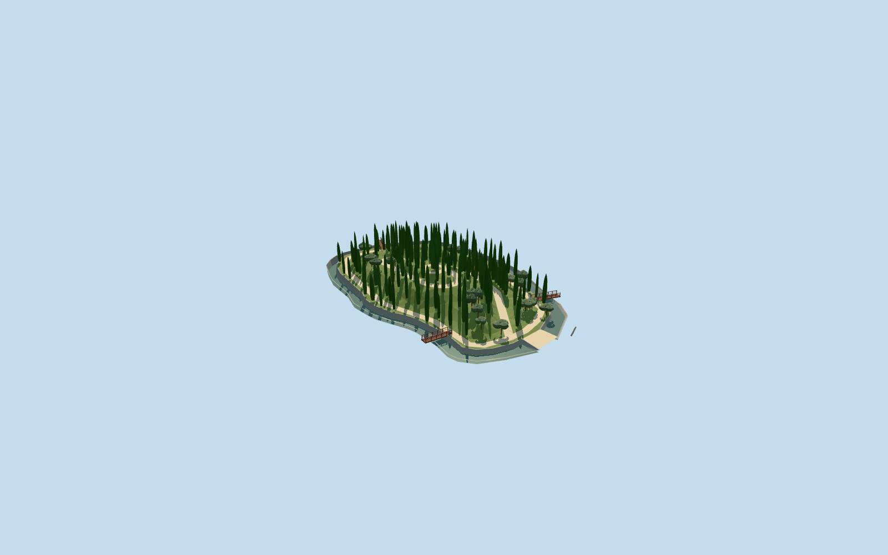

# Forest of Remembrance

Madrid’s Forest of Remembrance memorial mound with its north causeway, rising spiral, summit loop, granite-lined crescent channel, three timber bridges and fluted entrance column. The 170 cypresses and 22 olives follow the original planting inventory, with recorded tree points and inferred infill.

## Evidence and reconstruction

Published dimensions and reconstructed details are separated in spec.json. Primary references:

- [Reference](https://commons.wikimedia.org/wiki/File:Bosque_del_recuerdo-panoramica.jpg)
- [Reference](https://commons.wikimedia.org/wiki/File:Bosque_del_Recuerdo._Parque_del_Retiro._Madrid.jpg)
- [Reference](https://patrimonioypaisaje.madrid.es/portales/monumenta/es/Monumentos-y-Edificios-Singulares/Monumentos/Estanque-del-Bosque-de-los-Ausentes/?vgnextchannel=8fac3cb702aa4510VgnVCM1000008a4a900aRCRD&vgnextfmt=default&vgnextoid=ac88091d1b9c4510091d1b9c45102e085a0aRCRD)

No third-party geometry, photograph or bitmap texture is embedded. Shared surface graphs come from the central library; vertex tints carry model colors. Glazing uses PBR materials; transparent surfaces are declared per model.

## Model and axes

19,657 triangles; 58,971 vertices; 7 material groups; 2,362,828 bytes. Native bounds: -26.190, -0.500, -41.358 to 26.273, 16.093, 42.086. Source hash: `sha256:733833c7c2912e59eb8c10cd6c0efebb04359fb93f0f122bd34cc513bf8a7905`.

{"x":"east","y":"up","z":"south"}

The geographic proposal uses exact-QID OpenStreetMap evidence. Map-derived orientation and estimated architectural details require real-site visual review; preview eligibility is distinct from geographic/fidelity approval. Map attribution: © OpenStreetMap contributors, ODbL-1.0.

## Reproduce

Run `node content/worldgen/source/places/ez/ezj/forest_of_remembrance/models/generate-forest-of-remembrance.mjs --ids=forest_of_remembrance` (or add `--check`). The generator preserves manually edited masters by checking their baseline hashes. Import through the standard authored-model workflow with optimization disabled; then capture all QA cameras, including shared-surface views.

## Pending work

- The summit rises approximately 5.75 m above the entrance path in the model. Terraces, current tree heights, individual species assignment and unmapped planting positions are photo-led.
- The plaque is represented by its dark face. Inscription text and park furniture outside the memorial parcel remain outside the modeled scope.

This bundle follows the medium-fi standard. Medium-fi appearance and geographic fit are reviewed separately. Hash-bound visual acceptance is recorded separately after capture inspection.
