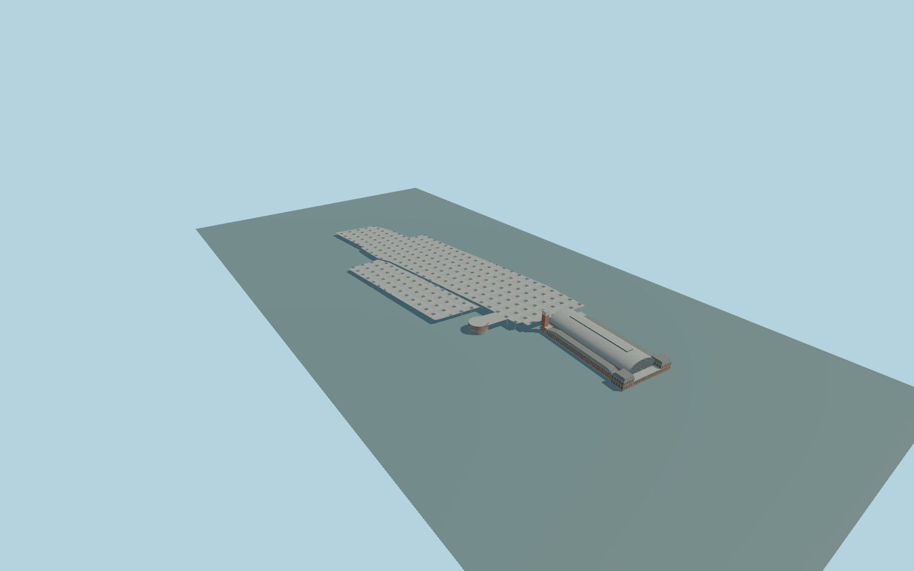

# Madrid Atocha railway station

Complete permanent Madrid Atocha passenger ensemble: historic iron-and-glass barrel hall,central glazed clock facade,twin brick entrance pavilions andlong masonry wings withmansard roofs,backservice ranges and35m clocktower;modern connectedumbrella/rooflight fields,roundbrick passengerpavilion andopen entranceportico. Preserveindependentneighbors,roads,rails andplatformground. No trains,brands,commerciallettering,people,sculptures or navigableinterior.

Rebuild: `node packages/worldgen/scripts/generate-madrid-atocha-railway-station.mjs`;append `--check` for exact source bytes. Select import/LOD/placement with `--ids=madrid_atocha_railway_station`. Detailed source and four browser tiers are separate ignored GLB outputs.

Complete permanent Madrid Atocha passenger ensemble: historic iron-and-glass barrel hall,central glazed clock facade,twin brick entrance pavilions andlong masonry wings withmansard roofs,backservice ranges and35m clocktower;modern connectedumbrella/rooflight fields,roundbrick passengerpavilion andopen entranceportico. Preserveindependentneighbors,roads,rails andplatformground. No trains,brands,commerciallettering,people,sculptures or navigableinterior.

Preserve native26m historicnave,25–27m rooflight,12m wings,17m frontpavilions and35m clocktower. Historic occupiedfloor+.65m,rear/round-pavilionfloor+4.8m,sourcefoot-16m. Native modernroof5m andlayer2 areexplicit mapfacts,not fullabsolutelevel controls:ordinary entrance/roofarray pictures motivate original modernmainroof13m nearhistoricend witha continuous-.012 sourcegrade alongtracks,andsecondaryroof8m with-.008 grade. Shallow1.1m hip/rooflights refineordinary aerialsquarepattern. Thisisone architecturalgrade,not per-part terrainoffsets or surveyedrails. Roundpavilion native10m ismeasuredfrom itsupperentryfloor4.8m,top14.8m;porticoroof12.8m. Layer-2connector remainsbelowgrade roofvolume,not aninvented aboveground building. Modernroofpattern/levels andhiddenopenings areapproximate. Onecommonunchangedglobalfield sample[-375,45],627.918716m,suppliesY=0. Exactnativecontact requirescurrentfieldreview. No per-parthostoffsets,blanketstationgroundmask orartificialplaza.

Three ordinary photos inspected: adequate historicfront,adequate modernroundpavilion/clock/canopyview,andsecondary broad aerial withstation crop. Aerial clipsfarhistoricend;current PMTiles supplieswholeplan. An attempted FCC aerial returnedHTML,soit isexcluded fromevidence. No further bespoke research. Exactmodernrooflight counts,hiddenopenings,lowerrailfloor andinteriorstructure remain original medium-fi approximations. Original exterioronly;hiddenopeninginventory,rooflightlayout andmodernrooflevels/grade areexplicit architecturalapproximations. Sculpturalfigures,brands,lettering,trains,peopleandcars areexcluded. Themainhistoricfloor isclosed;platformroof fields andportico stayopenbelow. Layer-2connector isaburiedclosedvolume,notabovegroundgroundmask. Physical-device timings andnumericalLODerrors remainunmeasured.

Sevenexisting256px sharedsandstone,concrete,brick,granite,paintedmetal,slate andwindow-grid graphs;eightmergedsemanticgroups becausemetalroof andstructuralmetal retainseparateslots. MetricUVs,linearcolors,no private/embeddedimages. Skylinekeepswholehall/wings/pavilions,clocktower,roundpavilion andbothfullroofoutlines. Districtaddscoarserooflightgrid andglazing. Streetaddsrealrecesses,terraceframes andsparseroofcolumns. Close-upaddsarchedmullions,roofribs,mansardrails andumbrellabrackets;master separatelyrefinescurves/windowframes androoflightmembers. LODerrorvalues areestimates.

Original geometry:repository license. Map:© OpenStreetMap contributors,ODbL-1.0;Protomaps. Standard terrain:terrain-grid.json. Ordinary pictures stay local and are not redistributed or used as textures. Current acceptance:qa.json.
