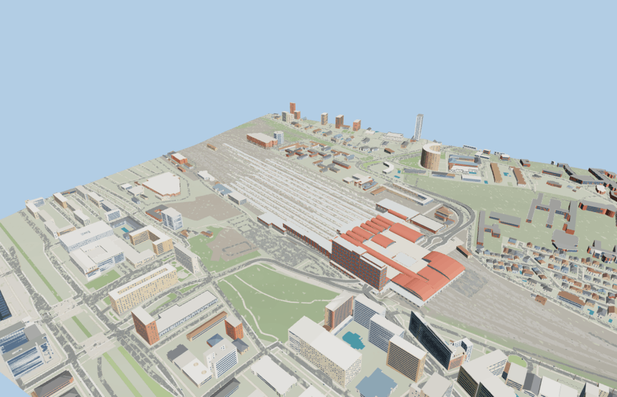

# Madrid-Chamartín Clara Campoamor

The geometric review covers the lower terminal, sixteen red barrel-vault roof groups and their recessed arched glazing, the supported terraces, the stepped hotel wing and eleven open platform canopy strips.

The common station reference is about 732.43 m at the western forecourt. Local grades uncover the lower entrance and the railway-side canopy lead-in. The viewer keeps all 1,012 road and rail records and all 465 independent building records in the focused fixture. The mapped replacement removes 44 station feature records from this crop.

Failed loading preserves the native layers. Eviction restores the ground and releases model geometry.

| Detail level | Triangles | Download bytes | Draws |
| --- | ---: | ---: | ---: |
| skyline | 931 | 82,892 | 1 |
| district | 3,966 | 343,240 | 7 |
| street | 13,608 | 1,209,408 | 7 |
| closeup | 60,962 | 5,624,752 | 7 |

Skyline and district total 426,132 bytes. Six GLBs pass Khronos validation and contain zero embedded images. Six shared material graphs bind in the viewer. The review covers 72 renders and 105 geographic samples.

The model depicts the mapped permanent passenger ensemble. Areas affected by the 2020s works use the retained plan and cited photographs.

The entrance thresholds and lower platform levels are approximate. Hidden façade details and roof fittings remain photo-based interpretations.

Rebuild with node packages/worldgen/scripts/generate-madrid-chamartin-clara-campoamor-railway-station.mjs. Add --check to verify exact bytes.

[Mapped site frame](map-frame.json) · [Terrain fit](site-fit.json) · [QA evidence](qa.json)
