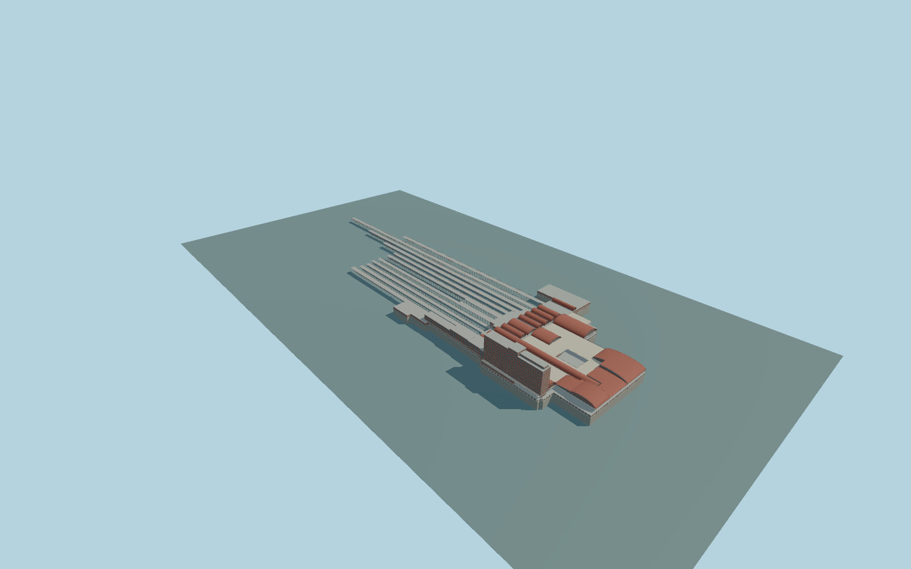

# Madrid-Chamartín Clara Campoamor railway station

Complete permanent Madrid-Chamartín connected passenger ensemble: mapped lower terminal and upper terraces,all sixteen red barrel-roof groups and arched glazed ends,the attached stepped hotel slab and elevated base,closed northern service ranges and all eleven distinct long open platform-canopy strips. Preserve independent Hotel Madrid Chamartín,Barceló Imagine,office towers,roads,rails,uncovered platform ground and neighboring buildings. No branding,trains,construction machinery or navigable interiors.

Rebuild: `node packages/worldgen/scripts/generate-madrid-chamartin-clara-campoamor-railway-station.mjs`;append `--check` for exact source bytes. Select import/LOD/placement with `--ids=madrid_chamartin_clara_campoamor_railway_station`. Detailed source and four browser tiers are separate ignored GLB outputs.

Complete permanent Madrid-Chamartín connected passenger ensemble: mapped lower terminal and upper terraces,all sixteen red barrel-roof groups and arched glazed ends,the attached stepped hotel slab and elevated base,closed northern service ranges and all eleven distinct long open platform-canopy strips. Preserve independent Hotel Madrid Chamartín,Barceló Imagine,office towers,roads,rails,uncovered platform ground and neighboring buildings. No branding,trains,construction machinery or navigable interiors.

Preserve native4.8m lower terminal,4.8–9m intermediate parts,9–9.2m terraces,14/15/17m terminal roof crowns and47/50/53m attached hotel steps. The physically connected Hotel The One POI lies inside the mapped hotel slab,not the independent Hotel Madrid Chamartín. One source-controlled lower track level-6m and5m-high canopies put roofY=-1m;this relative level is an explicit architectural approximation,not per-part terrain fitting or a surveyed rail elevation. Source occupied entry floors+.65m,upper terrace+9m,support feet-12m. Preserve all mapped min_height clearances and open platform space. One unchanged standard host sample atlocal[-195,-30],732.425977m,defines one commonY=0. No per-part terrain offsets or artificial plaza/rail floor. Source heights andlow track datum mustbe reviewedagainst unchanged native field;datum isnot surveyed.

Three ordinary pictures inspected:adequate2017aerial and2008front,plus train-obscured2023platform view used only for canopy construction. Permanent massing and distinctive barrel/glass/fascia families are observed. Exact hidden windows,roof-rib inventory,terrace rail/stair arrangement and platform level are original medium-fi approximations. Pictures precede or overlap major2020s works;present construction-stage appearance is unverified. The whole parent never becomesa solid groundfloor. Eleven canopies haveopen sides,branch brackets andsupport feet to-12m;actualplatforms,rails andcatenary remain native. Upperterrace holes remainopen,withattached halls in their mapped holes. Exterior only;no branded lettering,commercial details,people,vehicles or copied photo textures. Ground contact mustpass currentnative-field review. Physical-device timing andnumericalLODerrors remainunmeasured.

Six existing shared256px concrete,brick,granite,painted-metal,window-grid andstorefront graphs;seven semanticgroups because paintedmetal hasroof andstructural slots. MetricUVs,linearcolors,no private/embeddedimages. Skyline retainscomplete physicalensemble andallroofstrips withsimplifiedvaultcurves. District addscoarsepanes andcanopycolumns. Street addsactualrecesses,terracerails andhotelrows. Close-upaddsarchmullions,roofribs andbranchbrackets. Master separatelyrefinescurves andframe/ribinventory. NumericLODerrors areestimates.

Original geometry:repository license. Map:© OpenStreetMap contributors,ODbL-1.0;Protomaps. Standard terrain:terrain-grid.json. Ordinary pictures stay local and are not redistributed or used as textures. Current acceptance:qa.json.
