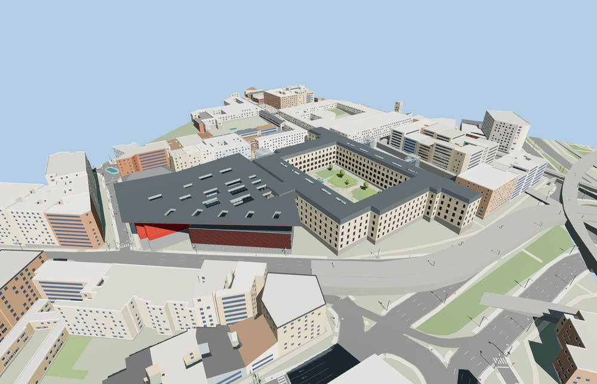

# Museo Reina Sofía

The Sabatini hospital frames a rectangular garden with an ashlar base, ordered limestone and lime plaster bays, and a dark roof. Twin glazed public lifts and the rear service lift contrast with the historic walls. Three Nouvel volumes form a public court under a tapered red canopy with nineteen daylight openings.

The 51,987-triangle source rebuilds byte for byte. Skyline, district, street and close-up use 903, 3,955, 11,923, 49,767 triangles. Skyline and district total 469,908 bytes. Six GLBs validated and 36 current views were inspected.

The model replaces four mapped museum records and retains 176 independent buildings and 158 road and path records. Three lift, fourteen stair, ten skylight, four soffit, five garden air and three court floor probes pass at all four levels. The four map footprints return if model loading fails.

The four PMTiles polygons and standard Terrarium terrain fix the exterior plan and signed orientation. Cornice, bridge and canopy elevations, panel rhythms and the garden planting are exterior photo estimates. The Sabatini garden and Nouvel court remain open. Gallery interiors, collection artworks, changing signage and exhibition furniture are outside the exterior scope.

Rebuild with `node packages/worldgen/scripts/generate-reina-sofia.mjs`. Append `--check` to compare exact bytes. Use `--ids=museo_nacional_centro_de_arte_reina_sofia` for targeted import, LOD, placement and readiness.
