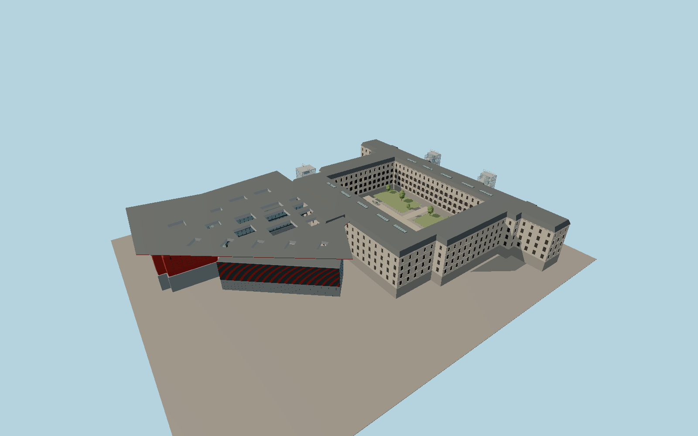

# Museo Reina Sofía

The Sabatini hospital frames a rectangular garden with an ashlar base, ordered limestone and lime plaster bays, and a dark roof. Twin glazed public lifts and the rear service lift contrast with the historic walls. Three Nouvel volumes form a public court under a tapered red canopy with nineteen daylight openings.

Run `node packages/worldgen/scripts/generate-reina-sofia.mjs` to rebuild the source master. Append `--check` to compare the exact bytes. Use `--ids=museo_nacional_centro_de_arte_reina_sofia` for targeted import, LOD generation and placement.

The four PMTiles polygons and standard Terrarium terrain fix the exterior plan and signed orientation. Cornice, bridge and canopy elevations, panel rhythms and the garden planting are exterior photo estimates.

The Sabatini garden and Nouvel court remain open. Gallery interiors, collection artworks, changing signage and exhibition furniture are outside the exterior scope.

Original geometry follows the repository license. Map data is © OpenStreetMap contributors under ODbL-1.0 via Protomaps. Terrain samples are described in terrain-grid.json. Ordinary pictures stay local and are not redistributed or used as textures. Current acceptance is recorded in qa.json.
