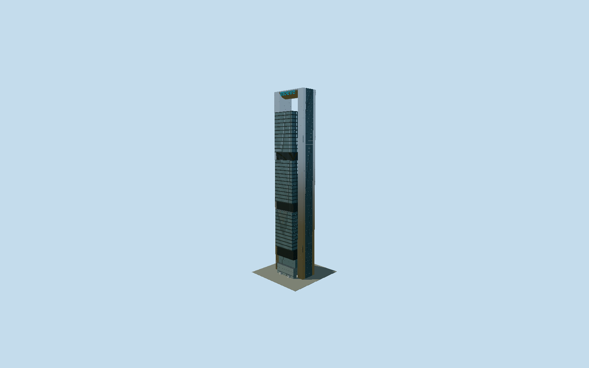

# Torre Moeve

Foster twin stainless-clad cores bracket three suspended black-framed glass office blocks, with recessed louver belts, panoramic end lifts, a13.85m glazed lobby and an open20m crown below a curved metal bridge bearing current blue Moeve lettering.

## Evidence and reconstruction

Published dimensions and reconstructed details are separated in spec.json. Primary references:

- [Reference](http://e-ache.com/modules/ache/ficheros/Realizaciones/Obra125.pdf)
- [Reference](https://www.gmsllp.com/portfolio/torre-caja-madrid/)
- [Reference](https://www.moeveglobal.com/stfls/corporativo/FICHEROS/informe-gestion-consolidado2025.pdf)
- [Reference](https://www.multivu.com/players/uk/7703451-cepsa-new-headquarters-new-company/docs/cepsa-headquarters-cepsa-tower-1046753785.pdf)
- [Reference](https://www.esmadrid.com/en/tourist-information/torre-moeve)
- [Reference](https://www.skyscrapercenter.com/building/wd/878)
- [Reference](https://www.openstreetmap.org/way/188396764)

No third-party geometry, photograph or bitmap texture is embedded. Shared surface graphs come from the central library; vertex tints carry model colors. Glazing uses PBR materials; transparent surfaces are declared per model.

## Model and axes

27,802 triangles; 81,374 vertices; 4 material groups; 3,265,916 bytes. Native bounds: -26.535, 0.000, -21.350 to 26.535, 248.315, 21.350. Source hash: `sha256:74c3f54ffe95520cd91789d9bf9e77c9089ab0841abbc4cdb057ce6e1950371b`.

{"up":"+Y","longAxis":"+X east-southeast between cores","shortAxis":"+Z south-southwest glass office frontage"}

Fresh2026-10-10 exactQ519568 cross-shaped way188396764 matches independently preserved original projected envelope within.001m numerical rounding. Separately mapped cores188396759/188396760 register east/west ends. Original anchor[-3.687751047,40.475715996] and heading-.20327044179 retain native+X east-southeast and +Z south-southwest. Actually inspected Burgos2008 printed174Figures1/2 plans and printed175 labeled northeast/south architectural views; original architect narrative explicitly places unoccupied cores east/west and glazed fronts north/south. Symmetric opposing cores, entrances and two-sided lettering leave no required asymmetric180degree side; canonical+X is signed geographic east by independent raw longitude. Published53x42.5m overall plan and10.5x23.5m core dimensions take precedence over small map variation; core outer/broad glass front envelopes agree within.6m, bearing allowance2degrees, not survey accuracy. Rounded inner-core corners, fine facade pitch and revolving-door positions are reconstructed; no independent door bearing claim. Raw map53floors and office bands disagree with primary49total/34office floors and39/102/168m transfer elevations; retain raw evidence and use primary construction datums. Y0 approximate lobby apron, no surveyed curb. No footprint replacement. Adjacent towers/plaza landscaping, interiors, underground garage and active lifts excluded.

## Reproduce

Run `node packages/worldgen/scripts/generate-signature-towers.mjs --ids=N0203` (or add `--check`). The generator preserves manually edited masters by checking their baseline hashes. Import through the standard authored-model workflow with optimization disabled; then capture all QA cameras, including shared-surface views.

## Pending work

- Original buildMoeve remains unchanged and byte-reproduces410898triangles/46682016bytes. Independent reviewed source preserves two full-height rounded-inside stainless cores/panoramic end-lift ribbons,32x42.5m three11/12/11office blocks at39/102/168m transfers, recessed mechanical belts/suspended auditorium,13.85m lobby, genuinely open crown with continuous curved bridge/top closure and two-sided blue Moeve lettering. Continuous shared brushed steel replaces dense individual1.12x1.35m closed sheet shells; near flat4.7m horizontal/2.24m vertical joint strips approximate panel rhythm. Flat projected black spandrels/mullions and pane-edge returns replace repeated closed beams; near2.1m bays replace original1.5m. Near curved-core corners6steps and crown32segments replace12steps/56segments; simplified24side original letter curves and revolving drums remain. Mechanical louvers sampled.46m rather than.23m; fine blade leading tubes/roof seams omitted. Four draw groups: shared stainless, paintedmetal, granite and opaque vision glass; revolving-door glazing also becomes an opaque pale-blue stylization. Skyline keeps closed cores/lobby/auditorium/three office blocks/inset belts and8segment open curved crown, omits doors, logo, panel/glazing rhythm/louvers. District restores8side doors/12side lettering, four-course wide glazing/panel bands and2.5m louvers. Street restores per-floor5m bays/9.4m core joints/1.15m louvers/16segment crown and12side doors/16side letters. Close-up restores per-floor2.1m glazing,4.7m core horizontal joints/2.24m vertical joints, pane returns/.46m louvers/32segment crown/24side letters and doors. Original source glass/depth datums retained; opaque drums do not claim clear interiors. Primary49total/34office floors and construction elevations override conflicting raw map53floors/office heights. Published248.3m registry height selected over early250m/215m cornice; modeled219.7m office roof remains construction reconstruction. Curved crown9.3m belly, panel modules/logo strokes/door positions are exterior approximations. Physical-device/dense-city timings, surveyed curb and global error bounds unmeasured.

This bundle follows the medium-fi standard. Medium-fi appearance and geographic fit are reviewed separately. Hash-bound visual acceptance is recorded separately after capture inspection.
