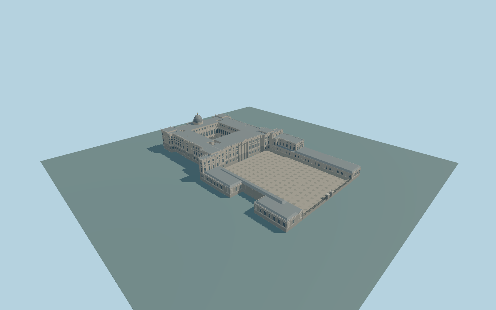

# Royal Palace of Madrid

Complete principal palace andArmeria complex:individual main quadrangle,open Prince court/deep ground galleries/tall glazed upper order/setback attic,three mapped service lightwells,north chapel dome,raised corner/central roof crowns,giant exterior orders,rusticated basement,lower U-shaped Armeria ranges/long open forecourt arcades,higher northeast Armeria pavilion,level court paving andopen central south gateway. Independent Almudena Cathedral,Royal Collections Gallery,museum/city blocks andgardens remain native context.

Rebuild: `node packages/worldgen/scripts/generate-royal-palace-of-madrid.mjs`;append `--check` for exact source bytes. Select import/LOD/placement with `--ids=royal_palace_of_madrid`. Detailed source and four browser tiers are separate ignored GLB outputs.

Complete principal palace andArmeria complex:individual main quadrangle,open Prince court/deep ground galleries/tall glazed upper order/setback attic,three mapped service lightwells,north chapel dome,raised corner/central roof crowns,giant exterior orders,rusticated basement,lower U-shaped Armeria ranges/long open forecourt arcades,higher northeast Armeria pavilion,level court paving andopen central south gateway. Independent Almudena Cathedral,Royal Collections Gallery,museum/city blocks andgardens remain native context.

Preserve the full individual275.6x164.5m palace/Armeria plan. Main roof excludes the Prince court andthree service lightwells. Main ground arcades are real deep galleries;their upper order is closed arched glazing,with the attic behind the upper terrace. Lower forecourt arcade bands remain open before closed range back walls. South gateway stays open between its actual mapped piers. All custom columns/urns/clock panels are original abstractions,no copied sculpture or lettering.

Approximate655m sea-level reference andunchanged193x193/2m/384m standard viewer field(two tiles). Common court/forecourt floor+4m(659m) is an original approximate level informed by the inner-field mean,not surveyed. Existing resident-only bounded ground cutouts cap obstructing urban DEM/native paving inside the actual palace andpaved Armeria forecourt atfloor-.05m;outside terrain remains native. Lower foundations/forecourt retaining edges reach the raw field. Photo-proportional main eave27.6m above paving,low wings9.2m,higher Armeria pavilion21m,chapel finial47.6m above paving. Native8/11/14/17/20m tags are generalized envelopes. Exact historic grades/thresholds/accessibility remain approximate.

Four ordinary aerial/facade/court pictures plusstandard PMTiles/global terrain only. Fine column/window/urn/statue inventories,roof junctions andsmall service-court details are original approximations. Optical room interiors excluded;closed glazing/doors terminate galleries. No private/embedded images,no bespoke survey/archive sourcing. Adjacent cathedral/museum andgardens excluded. Physical laptop/phone/dense-city timings unmeasured.

Five existing256px limestone,granite,painted-metal,window-grid andpainted-wood graphs;metric UVs/linear colors. Skyline preserves the individual U-plan,four roof voids,chapel dome,corner crowns,open galleries andcentral gate without fine glazing/ornament. District uses simplified boundaries,coarse shallow arches,sparse glazing andplanar orders. Street restores detailed boundaries,actual9/24 gallery bays,lightweight frames andcornice bands. Close-up adds round columns,urns,curved frame ribbons androof rails. Master retains dense round profiles,curved frames andbalusters. Error estimates3/1.5/.7/.25m are unmeasured approximations. Physical device timing unmeasured.

Original geometry:repository license. Map:© OpenStreetMap contributors,ODbL-1.0;Protomaps. Standard terrain:terrain-grid.json. Ordinary pictures stay local and are not redistributed or used as textures. Current acceptance:qa.json.
