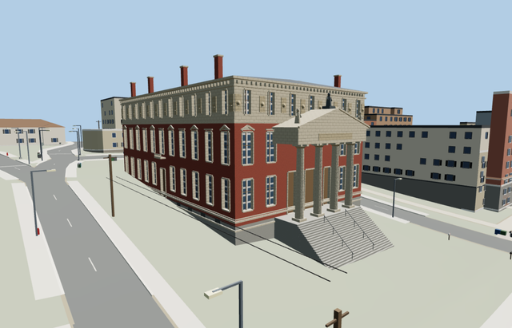

# Royal Spanish Academy

Reviewed 2026-11-14. **Current-world exterior and placement passed.**

Ordinary exterior photos identify the west portico, north balcony and projecting brick wing on Calle Moreto. The building has four fluted Doric columns with open intercolumniation, granite steps and rails, recessed timber doors, shaped rear window heads and a closed slate roof. [Academy exterior photographs](https://www.rae.es/la-institucion/la-rae/sede-institucional/descubra-la-rae/exteriores) · [Rear elevation photograph](https://commons.wikimedia.org/wiki/File:The_back_of_the_RAE.jpg)

The west portico faces Ruiz de Alarcón. The rear projection follows the east side of the matched PMTiles building. All four levels replace that one footprint. The lowest tread meets native terrain within about 4 cm in the viewer fixture. 48 neighboring building features and 34 road and path records remain in the fixture. A failed model load retains the mapped building. Unloading restores terrain and releases the model.

Seven existing shared brick, limestone, granite, slate, wood, painted-metal and punched-window graphs, with metric UVs and zero embedded images. Each graph used at close range loads once per site fixture.

## Source and checks

Rebuild with `node packages/worldgen/scripts/generate-royal-spanish-academy.mjs --ids=royal_spanish_academy`. The four runtime levels have 940, 3,792, 13,386, 19,458 triangles. Skyline and district total 402,164 bytes. Six GLBs passed validation and 64 rendered views passed inspection. [Review and hashes](qa.json)

Stairs and basement exposure follow the standard viewer terrain. Exact historic thresholds, stair count and wall ornament dimensions are approximate.

The model depicts the headquarters exterior. The source retains the coarse PMTiles height separately from the photo-proportioned silhouette.
