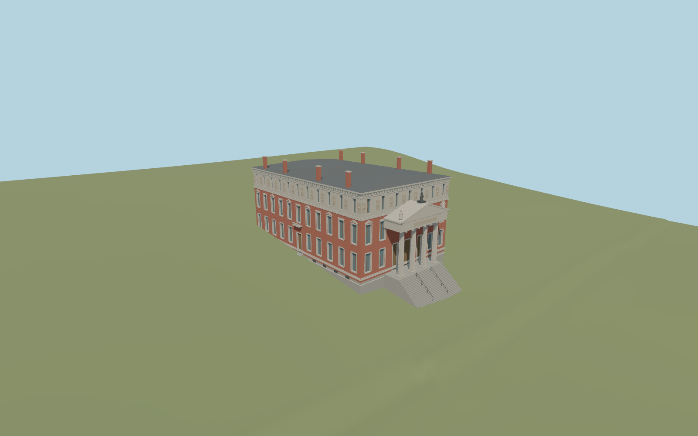

# Royal Spanish Academy

Madrid headquarters exterior with a red-brick main block, pale stone courses, eleven-bay north front and balcony, a four-column Doric portico and granite stairs on the west side, and the projecting brick rear wing and tall windows on Calle Moreto. The low slate roof retains eight chimneys. Garden fences and surrounding streets remain part of the map context.

Rebuild: `node packages/worldgen/scripts/generate-royal-spanish-academy.mjs`;append `--check` for exact source bytes. Select import/LOD/placement with `--ids=royal_spanish_academy`. Detailed source and four browser tiers are separate ignored GLB outputs.

The modeled main block measures about 28.4 by 44.2 m, with a 20 m cornice, 21.4 m roof and 23.4 m chimney caps. PMTiles records a coarse 8 m height. The model uses photo-based proportions. The original viewer terrain determines the west stair toe and rises toward the rear wing. The stair run has been fitted to the standard field and surveyed thresholds remain unknown.

The garden photo confirms the west portico and its broad granite stairs. The rear street photo shows a solid brick projection with tall upper windows, stone spandrels and a shallow cap. Stair count, rear decorative details, garden furniture and exact terrain grades are approximations.

Seven shared 256 px brick, limestone, granite, slate, wood, painted metal and punched-window graphs. Materials use metric UVs and linear colors. Skyline combines the main shell, both projections and the roof in one material group. The closer levels add recesses, masonry ornament and fluted columns.

Original geometry:repository license. Map:© OpenStreetMap contributors,ODbL-1.0;Protomaps. Standard terrain:terrain-grid.json. Ordinary pictures stay local and are not redistributed or used as textures. Current acceptance:qa.json.
