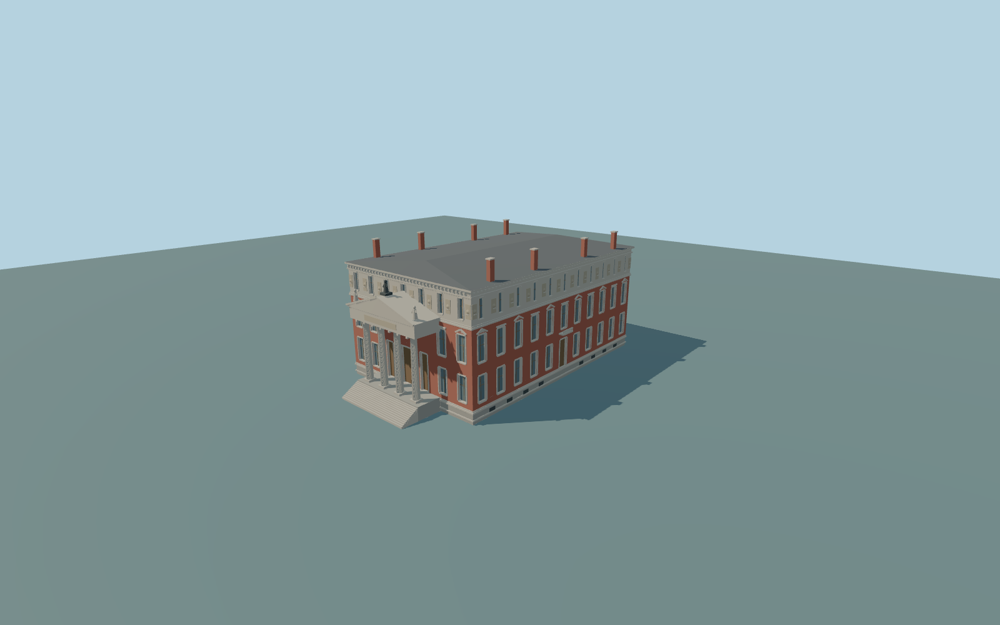

# Royal Spanish Academy

Complete principal Madrid headquarters exterior: red-brick rectangular main block with pale basement and attic, all four windowed elevations, eleven-bay north frontage with closed secondary door and small balcony, east principal four-column fluted Doric portico with genuinely open intercolumniation, closed entablature and triangular pediment, three closed entry doors and integral descending stairs, low closed slate hip roof with eight brick chimneys, continuous belt courses, dentil cornice and original geometric attic reliefs and pediment figures. Independent garden fence/gates, transient flags, vegetation, street furniture and neighbors remain native. No navigable interior or exact inscription/sculptural likeness is claimed.

Rebuild: `node packages/worldgen/scripts/generate-royal-spanish-academy.mjs`;append `--check` for exact source bytes. Select import/LOD/placement with `--ids=royal_spanish_academy`. Detailed source and four browser tiers are separate ignored GLB outputs.

Complete principal Madrid headquarters exterior: red-brick rectangular main block with pale basement and attic, all four windowed elevations, eleven-bay north frontage with closed secondary door and small balcony, east principal four-column fluted Doric portico with genuinely open intercolumniation, closed entablature and triangular pediment, three closed entry doors and integral descending stairs, low closed slate hip roof with eight brick chimneys, continuous belt courses, dentil cornice and original geometric attic reliefs and pediment figures. Independent garden fence/gates, transient flags, vegetation, street furniture and neighbors remain native. No navigable interior or exact inscription/sculptural likeness is claimed.

No retained numeric building height. Current map parent records 8m, which is retained as a conflicting coarse map fact. The photo-proportioned source has 20m cornice, 21.4m low roof and 23.4m chimney caps; main body is approximately 28.4 by 44.2m, with east stair/portico projection to local Z29.6m. These are approximate visualization controls, not surveyed dimensions. One unchanged field sample outside the east stair toe [0,31], 660.4381705m, supplies the common datum; closed occupied support extends to -8m and portico landing is +2.2m. The coarse urban field varies across the building, so exact historic basement/door/street grades require actual visual review.

Two ordinary exterior pictures and the current standard viewer PMTiles only. Distinct east and north elevations are observed; south/west window inventory, low roof shape and eight chimney positions are original medium-fi approximations. No copied relief, lettering, exact statue, interior or hidden roof survey. Current native height 8m conflicts with picture-proportioned body; no claim that the conflict is surveyed or resolved. Standard terrain fit is approximate; physical-device timing and numerical LOD errors remain unmeasured. No bespoke research.

Seven existing shared 256px brick, limestone, granite, slate, wood, painted metal and punched-window graphs. Metric UVs and linear colors, no private or embedded images. Skyline uses one palette group, closed window patches and coarse open portico. District adds closed recesses and shallow trim; street adds modeled frames, dentils, alternating window heads and geometric attic plaques; close-up refines fluted columns, original reliefs and figures. Source master preserves finer curves.

Original geometry:repository license. Map:© OpenStreetMap contributors,ODbL-1.0;Protomaps. Standard terrain:terrain-grid.json. Ordinary pictures stay local and are not redistributed or used as textures. Current acceptance:qa.json.
