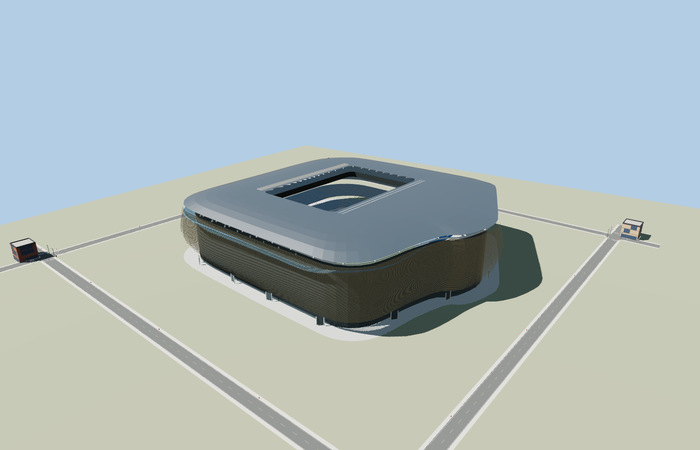
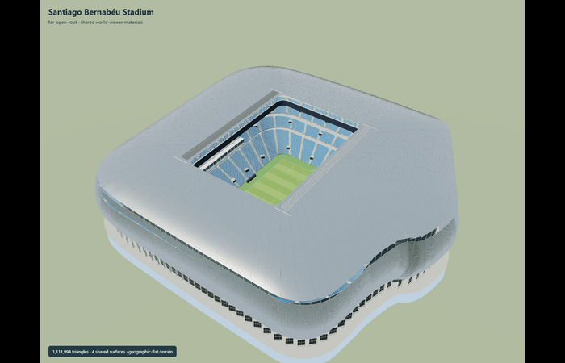

# Santiago Bernabéu Stadium

Reviewed2026-10-29. **Preserved detailed source master;four medium-fi browser tiers and retained approximate geographic scope accepted.**

Inspected68 current frames:11 portable and11 shared-material views of the preserved detailed master,27 final Earth/context/LOD views and19 actual Molen runtime-cutout views. The independently authored four browser tiers retain the asymmetric east bulge,silver bowed horizontal skin,open fixed roof,skywalk slit,four blue seating tiers and the depressed marked pitch. District groups louvres and seating slopes;street has24 louvre bands and21 grouped tread levels;closeup has60 louvre bands,all82 seating rows,44 radial V support units,selected return folds,goal frames and simplified western VIP boxes. Individual chairs,most louvre returns,minor roof joints,entry bays and concealed circulation details remain in the detailed master. The skyline now uses the same shared stainless finish as nearby tiers,preventing a bright palette-only material change. Angular corners,coarse louvre spacing and dense-line aliasing remain visible when distance tiers are forced close.

Four existing shared256px metal_stainless,metal_painted,concrete_plain and membrane graphs,metric UVs and linear vertex colors. Blue seating,turf and dark glass are local PBR factors. No private or embedded images. Skyline has two draws:shared steel plus a merged local palette;all nearby tiers have seven. Used graphs read once in each fixture and geometry disposes on unloading. Reflective steel inherits the engine sky/ground colors;the warm/brown reflection in the Earth rig is not a brown paint texture.

| Level | Triangles | Bytes | Draws |
| --- | ---: | ---: | ---: |
| skyline | 976 | 67940 | 2 |
| district | 3672 | 272812 | 7 |
| street | 14528 | 936804 | 7 |
| closeup | 62816 | 3843140 | 7 |

Detailed source master preserved byte-for-byte:1,111,994triangles /101492824bytes. Browser triangles 976 / 3672 / 14528 / 62816,bytes 67940 / 272812 / 936804 / 3843140,draws 2 / 7 / 7 / 7. Initial skyline+district 340752bytes;closeup 3843140bytes. Every tier meets its1000/4000/16000/64000triangle ceiling and eight-draw maximum. Separate POSITION/NORMAL streams prevent duplicate GPU uploads. Error settings8/4/2/1m are conservative authoring estimates,not certified whole-mesh distance measurements. No laptop/phone or downtown timing claim.

Exact mapped pitch controls origin/axis, current85-point exterior fixes eastern bulge. North-up frame aligns footprint and cutout with mapped envelope. Authored street ring covers the cut boundary atY0 while the field remains below. Correct west museum face and southern pitch axis retained; grade comes from the architect section rather than a geodetic survey. Retained anchor[-3.688354759398062,40.45305269079727] and heading-0.07332041354862007 are unchanged. Native+Z south/slightly west and+X east/slightly south. The same85-point closed outer outline supplies every browser model's street-grade concourse and the existing cutout. These are retained OSM/architect-derived controls,no new bespoke research or current PMTiles/DEM survey.

The actual Molen renderer was checked on the retained mapped outline with a synthetic flat street datumY0. All five loaded outputs replace the selected stadium building while preserving four independent building records,four roads,raw height samples and outside-ground heights within1e-6m. The pitch remains visible nearY-9.184 after removal of the covering terrain. All84 inset boundary samples find the modeled concourse atY0.01. Hiding restores ground at the pitch;showing clears it again. Failed model loading retains all five generic building records and four roads;unloading restores original ground geometry and leaves zero live model/support geometries. This is a real engine cutout/transform/lifecycle check,not validation of Madrid terrain heights or current nearby buildings. Exact surveyed grade,accessibility and physical-device timing remain unverified.

## Reconstruction limits

- Static match-day open-roof exterior; underground grass-storage mechanics and private rooms are not visible architecture. Folded roof membrane sections and small louvre support members are reconstructed from public roof photos. Individual ticket-seat counts and advertising/video content are not reproduced. Primary scaled section sets approximate grade relationships; no geodetic survey is claimed. Exterior wall height/bowing and facade section are photo reconstructions constrained by the mapped footprint and published overall dimensions.
- Detailed1,111,994-triangle source master and imported design-time master remain byte-identical to the retained maximum-fidelity exterior. Four separately authored medium-fi browser levels preserve the asymmetric mapped envelope,complete open roof,street-grade concourse and depressed field;they deliberately aggregate individual louvre returns,seats,concourse bays,small roof joints and concealed circulation structures.
- Skyline uses32 perimeter samples,two broad shell bands and four sloping seating bands. District uses48 samples,eight separated louvre bands,coarse V units and tier fascias. Street uses80 samples,24 louvre bands and21 grouped tread levels. Closeup uses112 samples,60 louvre bands,all82 seating rows,44 radial support units,selected return folds,goal frames and simplified western VIP boxes. Browser tiers contain no reproduced signage,video or private machinery.
- The full retained85-point outer outline supplies the street-grade concourse/cutout atY0;pitch remainsY-9.2 with its turf slab/markings. Source/map axis and approximate architect-derived grade remain retained controls,not a new geodetic or current PMTiles/DEM survey. Synthetic medium-fi stage lies below the pitch to reveal the complete geometry; actual Molen cutout/lifecycle checks use a flat street datum and are not terrain-data validation.
- Four existing shared256px stainless,painted-metal,concrete and membrane graphs;palette-only turf,blue seating and dark glass. No private or embedded images. Angular corners,coarse louvre spacing,stepped-seat aggregation and static tier changes are intentional. Error bounds are conservative authoring estimates,not certified whole-mesh Hausdorff distances. Physical laptop/phone and downtown timing remain unmeasured.
- Skyline keeps the same shared stainless graph as nearer levels to preserve its reflective finish,plus one merged palette group for the other surfaces:two draws rather than a bright untextured replacement. Standard context cameras use scale3 to remain outside this243m-wide stadium.
- Current medium-fi/browser acceptance is separate from the retained original maximum-fidelity source-master review. Portable/shared images were captured and inspected in this same pass;an explicit unchanged-master rebinding records the subsequent skyline-only finish and context-camera change,without claiming a new master render.
