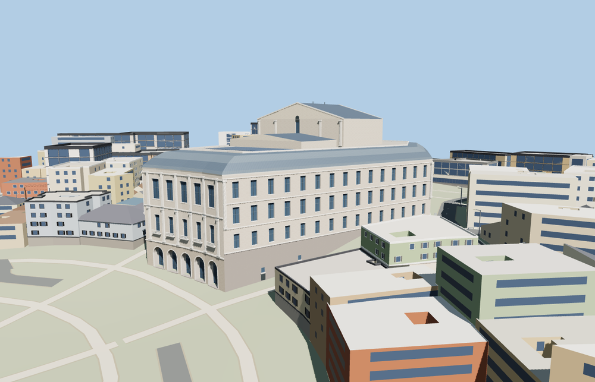

# Teatro Real

Madrid’s Teatro Real with the distinct five-arch plaza fronts, individually recessed entrances and window bays, angled side walls, standing-seam roof, roof terrace and gabled stage house.

The 18,381-triangle source rebuilds byte for byte. Skyline, district, street and close-up use 619, 3,405, 10,573, 17,753 triangles. The first two tiers total 351,484 bytes. Six GLBs validated and 38 current views were inspected.

Each tier passes 16 foundation contacts, ten entrance recess and threshold probes, four roof probes and four surrounding ground probes. The smallest sampled portal height is 6.07 m. The viewer retains 221 independent buildings, 122 mapped road parts, and the native terrain. Failed loading restores all eight original theatre features.

The footprint and major roof heights follow retained PMTiles building parts. Cornice dimensions, recessed door depths, terrace equipment and window framing are exterior photo-based estimates. The model represents the exterior, including the installed roof panel field as a simplified arrangement. Opera-house interiors, temporary banners and visitor access states are outside this model. Physical-device timings are unmeasured.

Rebuild with `node packages/worldgen/scripts/generate-teatro-real.mjs`. Append `--check` to compare exact bytes. Use `--ids=teatro_real` for targeted import, LOD, placement and readiness.
