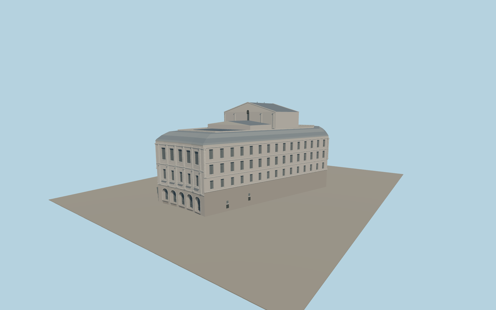

# Teatro Real

Madrid’s Teatro Real with the distinct five-arch plaza fronts, individually recessed entrances and window bays, angled side walls, standing-seam roof, roof terrace and gabled stage house.

Run `node packages/worldgen/scripts/generate-teatro-real.mjs` to rebuild the source master. Append `--check` to compare the exact bytes. Use `--ids=teatro_real` for targeted import, LOD generation and placement.

The footprint and major roof heights follow retained PMTiles building parts. Cornice dimensions, recessed door depths, terrace equipment and window framing are exterior photo-based estimates.

The model represents the exterior, including the installed roof panel field as a simplified arrangement. Opera-house interiors, temporary banners and visitor access states are outside this model.

Original geometry follows the repository license. Map data is © OpenStreetMap contributors under ODbL-1.0 via Protomaps. Terrain samples are described in terrain-grid.json. Ordinary pictures stay local and are not redistributed or used as textures. Current acceptance:qa.json.
