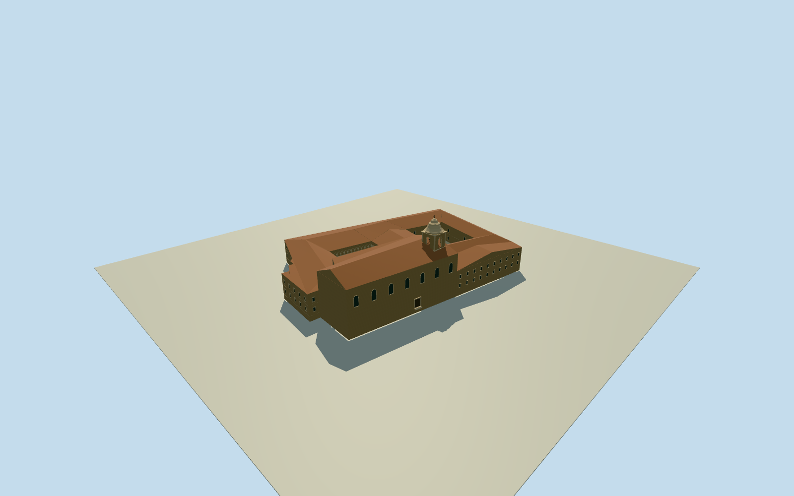

# Abbey of Santo Domingo de Silos (1892)

Complete physical Abbey of Santo Domingo de Silos in an explicit1892drawing-led historical phase: whole two-court monastery residential/service wings, intrinsic monastic church SanSebastian and closed roofs/rear/sides, defining baroque bell tower and Romanesque lower/upper cloister galleries. Actual modern physical footprints supply approximate historical registration/layout, not surveyed1892walls; hidden roofs/sections/census bounded estimates. The square tower/rosewindow on right of drawing belongs separate SanPedro east of abbey and is excluded, together with broader religious grounds, detached southern annex, village houses, vegetation/people/copying sculpture. Later2007PD-self lower-cloister photo informs retained medieval architectural character only, not1892condition or modern garden.

Authoring state: **review-in-qa.json**. Current completion evidence is in [qa.json](qa.json) and the [completion ledger](../../../../qualla-structures/batches/qualla-002.PROGRESS.md).

- [Abbey of Santo Domingo de Silos](https://qualla.com/abbey-of-santo-domingo-de-silos/)

Physical monasteryrelation2641315/22controls/two8controlcourts plus intrinsic monasticchurchrelation14168825/Q108040783/9controls and connectednorthwestserviceblock provide approximate historical context. Main religiousgroundsrelation14168823/Q1340405 not extruded. SeparateSanPedro way49039876 and detachedsouthernannex14168824 excluded. Original1892drawing shows abbeybaroquebelfry onleft and separateSanPedro onright; onlyabbeyincluded. Historical registration±10m/bearing±10degrees and hidden topology/section estimates explicit.

Full monastery plus intrinsic monasticchurch, not façade-only or narrow standalonecloister; neither separateSanPedro tower onrightofoldimage nor broadreligiousgrounds adopted.

All hidden historicalbody/roof/section/baycensus and originalcloistercondition bounded estimates; not1892survey or current-state claim.

Original independentfield/frame before allmainparameters. Neverflatten/reacquire/reframe or fitfloors/mainsections to renders.

Baroque abbey tower is left in1892image. SeparateSanPedro squaretower/rosewindow onright excluded; no SanPedro geometry borrowed. Towerlocation/bearing within monasticchurch estimated±10m/±10degrees, heightsections±25percent.

Whole current monasticchurchrelation14168825 and connectednorthwestservicewing included with monasteryrelation2641315/two8controlcourtvoids, as approximate historicalcontext. Detachedsouthernannex/broadergrounds excluded; hiddenhistoric extents/roof topology remain explicitestimates.

Full two-level Romanesquegallery exterior retained with realopenarches/pairedshafts/coveredfloors and ceilings. Groundcensus14/12/14/12anduppercensus same are estimated;2007oldform photo not a1892condition survey. Figurativecapitalcarving simplified plainflaredcapitals/twistedshafts, no sculpturecopied.

Roofmaterialtile/color and hiddenroofsections are estimates from uncolored1892drawing. Sourcefield/frame/allfloors/mainparameters preserved, no broadsitepad/cutout.

Build: `node content/worldgen/source/places/ez/ezm/abbey_of_santo_domingo_de_silos/models/generate-house.mjs`. Add `--check` to verify exact regeneration. 55137 triangles; 6 materials; no embedded photographs.
