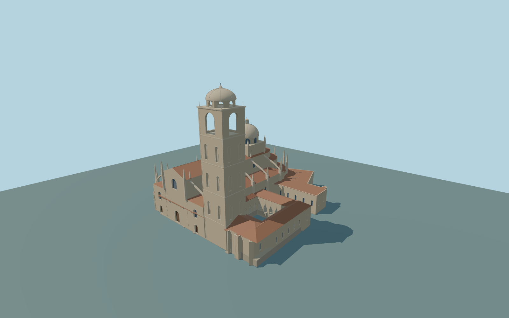

# Segovia Cathedral

Complete principal Segovia Cathedral exterior:entire irregular nativeparent footprint withopencloister,highnave/clerestory andloweraisle masses/terracotta roofs,three approximate framed closedfront portals andglazedfront windows,stepped/flying buttresses andpinnacles,layered polygonal SE apse/chapel roofs,large octagonaldrum/ribbed centraldome/lantern,90m greatbell tower withreal four-face belfry openings/blindshaft panels/domestop,a smaller slate-capped octagonalportal turret,allconnected rear/side ranges andfour complete cloisterroof/arcade wings. Originalgeometric trim only;exactsculptures,inscriptions,hidden doors/roofinventory andnavigableinteriors areoutside scope. Independent cityneighbors andcourt ground remainnative.

Rebuild: `node packages/worldgen/scripts/generate-segovia-cathedral.mjs`;append `--check` for exact source bytes. Select import/LOD/placement with `--ids=segovia_cathedral`. Detailed source and four browser tiers are separate ignored GLB outputs.

Complete principal Segovia Cathedral exterior:entire irregular nativeparent footprint withopencloister,highnave/clerestory andloweraisle masses/terracotta roofs,three approximate framed closedfront portals andglazedfront windows,stepped/flying buttresses andpinnacles,layered polygonal SE apse/chapel roofs,large octagonaldrum/ribbed centraldome/lantern,90m greatbell tower withreal four-face belfry openings/blindshaft panels/domestop,a smaller slate-capped octagonalportal turret,allconnected rear/side ranges andfour complete cloisterroof/arcade wings. Originalgeometric trim only;exactsculptures,inscriptions,hidden doors/roofinventory andnavigableinteriors areoutside scope. Independent cityneighbors andcourt ground remainnative.

Retained90m andnative88m greattower arebothrecorded;sourceupper dome87.5m andfinial90m areanapproximate interpretation,not a reconciledsurvey. Currentparent114.08by98.16m andtower17.89by16.11m guide extent/position. Nave33.5m walls/38.6m ridge,loweraisles20.6m/24m roofs,threeapse tiers,central47.5–57m dome/62m finial,44m portal turret,cloister14.3m eaves andbuttress/pinnacle rhythms areordinary-picture proportions. Y=0 usesone unchanged host sample outsideNW front[-19,58],1014.8602535m;sourcefloor+.3m/support-8m. Standardcityhill field containsurban returns;exactdoor/court/street grades remainapproximate. The four occupied cloister passage floors are approximately stepped to +4.1m, with pointed arches from +4.1m to +11.8m below the unchanged +14.3m eaves. This is an original standard-field-informed interpretation: the unmodified courtyard sample is about +3.8m above the common front datum. It is not a surveyed historic floor level. The court remains native and open, with no floor, roof or ground mask across it.

Onlytwo ordinarywhole/major-front pictures,current standardPMTiles andone unchanged globalTerrarium tile. Aerial suppliesmainroof inventory andopencloister;front picture cropslowerdoors,so threefront portals/hiddenranges/finebuttresses/pinnacles/windowspacing areoriginal medium-fi approximations. No exactornament/inscription/sculpture ornavigableinterior. Native field varies across the 114m complex; exact doorway, court and street grades remain approximate. No bespoke survey/archive/alternate terrain research. NumericalLOD errors andphysical-device timing remainunmeasured.

Six existing shared256px rawlimestone,ceramic tile,slate,wood,paintedmetal andpunched-window graphs insix groups maximum,metricUVs/linearcolors,zero embedded/private images. Source master preservesfull3D moldings/niche/curvedroof profiles. Runtimelevels useshallow trim bands. Skyline keepsentire floor/open court,majorvolumes/roofs/towers andrealcoarse four-face greatbelfry openings,withflatfacade/door plates,closed upperdrum/arcade proxies andsimplified portal cap/apse tier. District addscolored windowplates,pinnacles andtwo broadreal courtyard arches/face;street usesrealwindow recesses/fivecourt arches,whileblindshaft panels areshallowbands;closeup/master addfullblindniches,smallreturn windows,upperlantern openings/courses/ribs. NominalLOD errors arenotmeasured surface errors.

Original geometry:repository license. Map:© OpenStreetMap contributors,ODbL-1.0;Protomaps. Standard terrain:terrain-grid.json. Ordinary pictures stay local and are not redistributed or used as textures. Current acceptance:qa.json.
