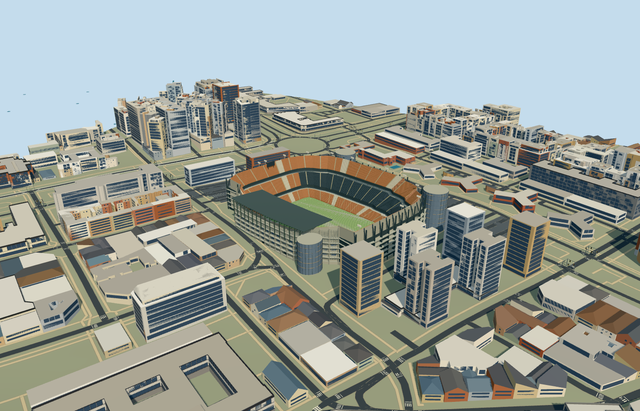

# mestalla_stadium — Mestalla Stadium

Reviewed 2026-10-20 in one continuous author/build/inspect/fix round.

## Appearance

Inspected48 current portable/shared/medium-fi/native-city frames in the same ordinary-picture/PMTiles/build/inspect/fix pass, including full-sized west-gallery/roof-underside/glazed-core views. Specific unequal steep orange/dark three-band bowl/open field; lower western covered stand with closed native canopy/dark renderable underside/connected rafters/lights; higher uncovered eastern/end terraces/exposed rakers and supported light/display frames; pale five-gallery west frontage/recessed closed entries/physical close-up square grille, dark exposed east facade; three rounded glazed circulation cores/caps/projecting supported floor bands and neutral105x70m football floor/goals. Corrected concourse closure, light-foot attachment to actual terrace edges, coplanar core bands, close-up grille readability and tiny native mask corner remnants. No visible missing side/duplicate old shell. Quiet panels replace mural portraits/emblems/seat lettering. Portable/synthetic flat ground exposes individual core grade offsets; native views verify placement.

## Shared materials and browser levels

Six existing256-square graphs: concrete_plain, metal_painted, metal_standing_seam, window_grid, metal_perforated_square and fabric_canvas. Concrete supplies structure/galleries/footings/physical grille bars; tinted paint supplies orange/dark/pale seats/aisles/dark rakers/quiet facade fields/bands/marks/screens; standing-seam supplies the gray canopy, window-grid closed facade/core glazing, shared square-perforation graph a grille approximation and canvas approximate turf grain. Physical concrete grille bars refine close-up scale; street/district retain the shared fine pattern. Six near draws, zero embedded images or unique atlas/copied photo pixels. Metric repeats/linear tints and each nearby graph read once. Separate POSITION/NORMAL uploads and equal reported CPU/GPU geometry bytes, disposal verified. Shared glazing/grille/corrugation are medium-fi approximations, not an exact color/optical/screen survey.

| Level | Triangles | Bytes | Draws |
| --- | ---: | ---: | ---: |
| skyline | 764 | 68392 | 1 |
| district | 3298 | 285312 | 6 |
| street | 13624 | 1208916 | 6 |
| closeup | 41550 | 3960304 | 6 |

Inspected24 current noon/late Economy/High street/block/skyline/silhouette/matched-level/transition frames. All four levels retain unequal open terraces, one western canopy and three core silhouettes; near levels refine tread/riser/aisle/gallery/core bands and roof framing; close-up adds physical square grille bars. Rows/mullions/rafter/light inventory deliberately coarsen at distance. Levels764/3298/13624/41550triangles; initial skyline plus district353704bytes, at most six draws. Synthetic context is not geographic evidence. Physical ordinary-laptop/phone/dense-city timings remain pending. Levels764/3298/13624/41550 triangles; at most six draws.

## Approximate map fit

Exact-QID OSMway8082830 identifies existing Mestalla independently of Nou Mestalla. Parents52776566019556/35185611774285 and western canopy35185494921366 supply stadium/upper terrace horseshoe/canopy; all three records are completely removed in the loaded fixture. Own anchor[-.3582414068627656,39.474615196760396]/heading0/native east-south; internal X[.19611605455166886,-.9805806918082197]/Z[.9805806918082197,.19611605455166886] follows116.797693x78.739026m central opening. ModelZnegative/west carries the sole canopy; eastern/end stands stay uncovered. Main bowl excludes the three mapped-position core lobes before terrace construction; no seats cross the core ellipses. Club105x70m pitch is not stretched to site dimensions.25mm guards preserve sharp owned corners, removing the earlier tiny/degenerate remnant without touching independent footprints. All1616 independent resident inputs of1619 originals/3099 wider records, original6m terrain/native roads and13588.28147731203m2 water unchanged. Each facade pier/core has a retained contact. Occupied supported floor/bounded opening within90percent main bowl/common floor handles coarse terrain without original-sample/outside/water edits. Failure keeps1619 originals/original ground; every level unload restores ground/water/zero live model geometry. No entire neighborhood/plaza slab.

## Limits

Four ordinary pictures actually viewed: undated official facilities match hero/empty tour bowl, Anidae2023-12-16 facade with glazed core and Joanbanjo2013-11-07 west galleries. Rights/CC BY-SA4.0/3.0 metadata retained; viewed only, no pixels copied. Clubpage states105x70m pitch. Native40m height lacks qualified datum; working eastern/end40m/western27.2m, canopy32..35m, core tops28.5/42/42m and gallery/light/display/row/core radii are visualization estimates. Core centers/radii approximate retained mapped lobes, not surveyed foundations or hidden circulation. Fine20degree/2m facing, exact seating/bat/lettering pattern, mural portraits/club artwork, screen/grid/rail/rafter/step inventory and later repainting/current equipment are unverified or excluded. No copied sponsor/emblem atlases, furnished interiors, access-slope or structural certification. Anchor17.262446636732328m/local contact samples and bounded ground opening address coarse standard terrain, not a measured excavation or terrain survey. Shared grille/perforation/window/roof/turf finishes are approximate; core glazing is not an optical transmission simulation. Flat synthetic ground does not represent individual contact offsets. Neutral football excludes crowd/event artwork; independent Valencia blocks/street infrastructure remain native. Physical device/dense-city performance remains unmeasured.

## Selected checks

Six Khronos files: zero errors/warnings.3211 actual mesh/material/contact checks; 48 current inspected views. Scene validation/sim30 and strict selected medium-fi audit pass. Source/runtime/LOD hashes and material bindings verified.

Rebuild: node packages/worldgen/scripts/generate-additional-landmarks.mjs --ids=mestalla_stadium; node packages/worldgen/scripts/import-structure-models.mjs --ids=mestalla_stadium; node packages/tooling/scripts/generate-landmark-lods.mjs --ids=mestalla_stadium --force.

Source: sha256:7bec68c5fc5540ea029d52def3906ecc2e540d0caf35f0a1355d82676d535c55

Runtime: sha256:19b5707580125ee85bf960455fb2742208f9ffe461b02628ae02e659a681ffb7

Input: sha256:bc6a242462dfd8cd47046299b61ca1a28159d0eb9e14ce399f86bd0f0e4d8a6a

## Viewed ordinary pictures

https://www.valenciacf.com/mestalla-stadium — Official existing Mestalla facilities hero; Valencia CF; individual photographer not named; Copyright retained by rights holder; viewed only/no pixels copied. Viewed only; no pixels copied.

https://www.valenciacf.com/mestalla-forever-tour1 — Mestalla Forever Tour empty-bowl panorama; Valencia CF; individual photographer not named; Copyright retained by rights holder; viewed only/no pixels copied. Viewed only; no pixels copied.

https://commons.wikimedia.org/wiki/File:Fachada_exterior_del_Mestalla_antes_del_partido_Valencia-Barcelona_LaLiga_2023-2024.jpg — Fachada exterior del Mestalla antes del partido Valencia-Barcelona LaLiga2023-2024; Anidae; CC BY-SA4.0 as stated on file page; viewed only/no pixels copied. Viewed only; no pixels copied.

https://commons.wikimedia.org/wiki/File:Façana_de_l'estadi_de_Mestalla_a_l'avinguda_de_Suècia.JPG — Facade at Avinguda de Suecia; Joanbanjo; CC BY-SA3.0 as stated on file page; viewed only/no pixels copied. Viewed only; no pixels copied.
