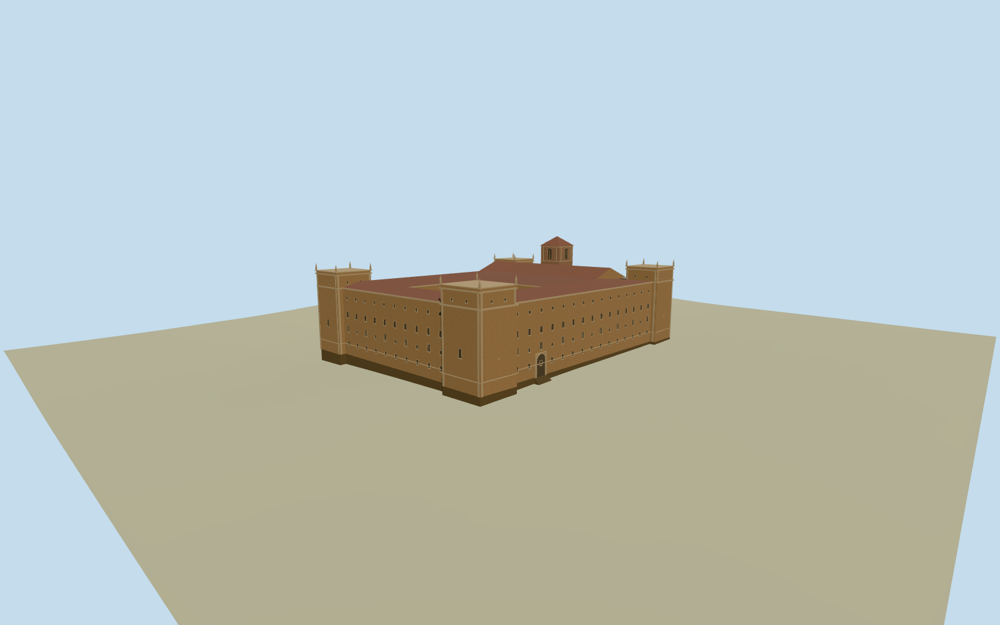

# Monastery of Santa Maria, El Puig

The royal convent at El Puig with four defensively styled stone towers, a roofless cloister and the northern sanctuary and belfry.

Authoring state: **review-in-qa.json**. Current completion evidence is in [qa.json](qa.json) and the [completion ledger](../../../../qualla-structures/batches/qualla-004.PROGRESS.md).

- [Monastery of Santa Maria, El Puig](https://qualla.com/monastery-of-santa-maria-el-puig/)

Standing convent, sanctuary and courtyard exterior. The surrounding public terraces and interior rooms lie outside scope.

Exact heights, minor roof junctions and concealed elements are estimated from photographs.

Build: `node content/worldgen/source/places/ez/ezp/monastery_of_santa_maria_el_puig/models/generate-monastery-of-santa-maria-el-puig.mjs`. Add `--check` to verify exact regeneration. 14247 triangles; 6 materials; no embedded photographs.
