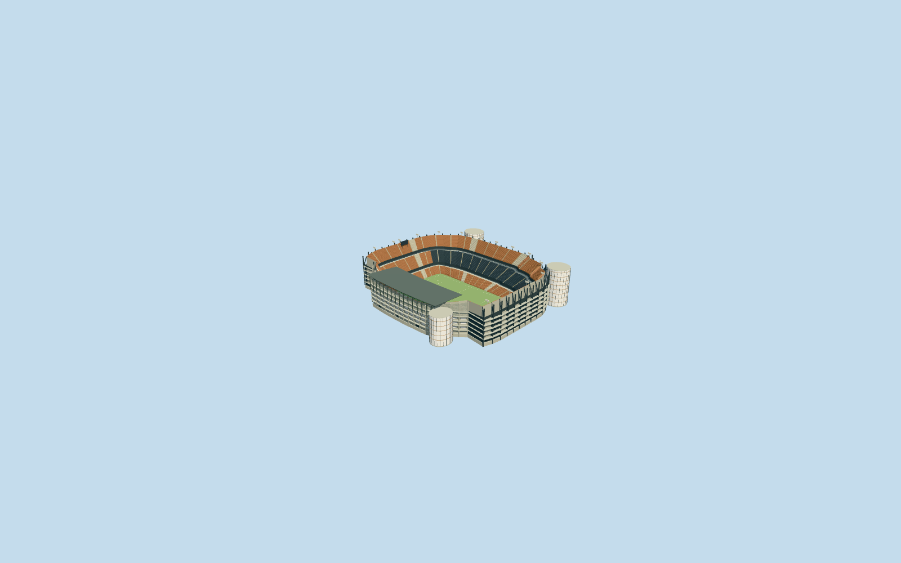

# Mestalla Stadium

Specific existing Mestalla Stadium: mapped unequal steep three-band orange/dark bowl/open field, lower western covered stand with own closed native canopy/dark renderable underside/rafters/lights, taller uncovered eastern/end terraces with exposed rakers/high light racks and supported end displays, five gallery/deck rhythms/pale west concrete-square grille/recessed closed services and entries/dark east structural facade, three mapped-position rounded glazed circulation cores with closed caps/colored supported floor bands and neutral football floor/markings/goals. Six existing shared concrete/paint/standing-seam/window-grid/perforated-square/canvas graphs. No Nou Mestalla substitution, whole neighborhood/plaza slab, copied portraits/emblems/seat lettering/sponsor textures or furnished service interiors.

## Evidence and reconstruction

Published dimensions and reconstructed details are separated in spec.json. Primary references:

- [Reference](https://www.valenciacf.com/mestalla-stadium)
- [Reference](https://www.valenciacf.com/mestalla-forever-tour1)
- [Reference](https://commons.wikimedia.org/wiki/File:Fachada_exterior_del_Mestalla_antes_del_partido_Valencia-Barcelona_LaLiga_2023-2024.jpg)
- [Reference](https://commons.wikimedia.org/wiki/File:Façana_de_l'estadi_de_Mestalla_a_l'avinguda_de_Suècia.JPG)

Specific existing Mestalla Stadium: mapped unequal steep three-band orange/dark bowl/open field, lower western covered stand with own closed native canopy/dark renderable underside/rafters/lights, taller uncovered eastern/end terraces with exposed rakers/high light racks and supported end displays, five gallery/deck rhythms/pale west concrete-square grille/recessed closed services and entries/dark east structural facade, three mapped-position rounded glazed circulation cores with closed caps/colored supported floor bands and neutral football floor/markings/goals. Six existing shared concrete/paint/standing-seam/window-grid/perforated-square/canvas graphs. No Nou Mestalla substitution, whole neighborhood/plaza slab, copied portraits/emblems/seat lettering/sponsor textures or furnished service interiors.

## Model and axes

41,550 triangles; 124,650 vertices; 6 material groups; 4,989,916 bytes. Native bounds: -94.435, -3.381, -105.249 to 120.432, 45.000, 117.502. Source hash: `sha256:7bec68c5fc5540ea029d52def3906ecc2e540d0caf35f0a1355d82676d535c55`.

{"x":"east","y":"up","z":"south"}

The geographic proposal uses exact-QID OpenStreetMap evidence. Map-derived orientation and estimated architectural details require real-site visual review; preview eligibility is distinct from geographic/fidelity approval. Map attribution: © OpenStreetMap contributors, ODbL-1.0.

## Reproduce

Run `node packages/worldgen/scripts/generate-additional-landmarks.mjs --ids=N0716` (or add `--check`). The generator preserves manually edited masters by checking their baseline hashes. Import through the standard authored-model workflow with optimization disabled; then capture all QA cameras, including shared-surface views.

## Pending work

- Specific existing Mestalla Stadium: mapped unequal steep three-band orange/dark bowl/open field, lower western covered stand with own closed native canopy/dark renderable underside/rafters/lights, taller uncovered eastern/end terraces with exposed rakers/high light racks and supported end displays, five gallery/deck rhythms/pale west concrete-square grille/recessed closed services and entries/dark east structural facade, three mapped-position rounded glazed circulation cores with closed caps/colored supported floor bands and neutral football floor/markings/goals. Six existing shared concrete/paint/standing-seam/window-grid/perforated-square/canvas graphs. No Nou Mestalla substitution, whole neighborhood/plaza slab, copied portraits/emblems/seat lettering/sponsor textures or furnished service interiors.
- Exact-QID retained OSMway8082830 identifies existing Mestalla, independent of Nou Mestalla. Native parents52776566019556/35185611774285 and western canopy35185494921366 provide whole envelope, larger uncovered terrace horseshoe and actual covered-stand footprint. Own anchor[-0.3582414068627656,39.474615196760396]/heading0/native east-south, internal X[0.19611605455166886,-0.9805806918082197]/Z[0.9805806918082197,0.19611605455166886] follows116.797693x78.739026m central opening. Main bowl envelope excludes the three own circulation core footprints with70cm clearance; cores are rebuilt at explicit local offsets rather than stretching seats through them. Lower covered side lies at modelZnegative/west; end and eastern upper stands stay uncovered. Club page lists105x70m pitch; not the larger roof/bowl dimensions. Fine portal/seat/core-facing allocation retains20degree/2m visual uncertainty.
- Native parent40m height has no qualified datum; it is retained as unqualified map context. Working eastern/end upper terraces40m, western scale68percent/27.2m, canopy32..35m, round core tops28.5/42/42m and three tier/gallery/light/display allocations are picture-led visualization estimates. Three core local centers[-59.2,-72.2]/[-91.5,75]/[55.2,99.2] and elliptical radii10.7x12/13x12.6/13x12.2m approximate mapped lobes; these are not surveyed foundation or circulation dimensions. Gallery rails/screen/perforation/step inventory and20degree/2m facing are approximate. Six shared material graphs approximate concrete grille/glazing/roof/turf; exact portrait/club-art/seat-mosaic inventories and concealed interiors excluded. Official105x70m pitch is retained; neutral goal/line inventory is not sports certification. Photos span2013/2023/undated club heroes; later physical changes/repainting/current equipment remain unverified.
- Original standard6m Mapzen samples/native roads/water and every independent apartment/building input remain unchanged. Anchor sample defines modelY0; each facade column and each round core retains its own local contact. Bounded occupied retaining floor/core footings and opening inside90percent main bowl/common supported floor handle coarse grade; not a surveyed excavation. Only three same-stadium native records are replaced. No entire street/plaza platform, original-sample flattening or water cutout. Failure/unload keep/restore original ground/context.

This bundle follows the medium-fi standard. Medium-fi appearance and geographic fit are reviewed separately. Hash-bound visual acceptance is recorded separately after capture inspection.
