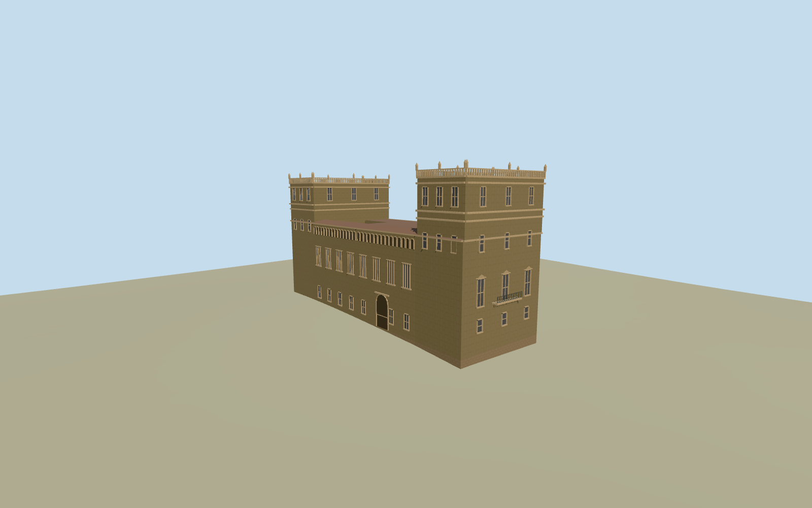

# Palace of the Generalitat Valenciana

The Palau de la Generalitat in València, with the old and new stone towers, Gothic street frontage, and two courtyards.

Authoring state: **review-in-qa.json**. Current completion evidence is in [qa.json](qa.json) and the [completion ledger](../../../../qualla-structures/batches/qualla-004.PROGRESS.md).

- [Palace of the Generalitat Valenciana](https://qualla.com/palace-of-the-generalitat-valenciana/)

The palace exterior, open courtyards and visible courtyard stair. Underground spaces and occupied interiors are outside scope.

Unpublished cornice, tower and balustrade dimensions are estimated.

Build: `node content/worldgen/source/places/ez/ezp/palace_of_the_generalitat_valenciana/models/generate-palace-of-the-generalitat-valenciana.mjs`. Add `--check` to verify exact regeneration. 22553 triangles; 6 materials; no embedded photographs.
