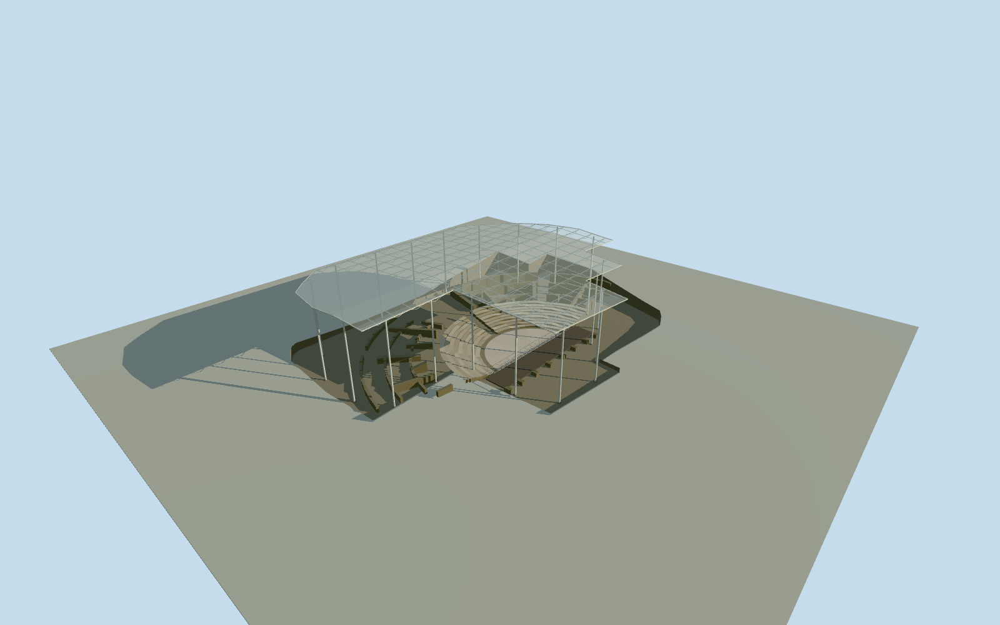

# Roman Theater of Caesaraugusta, Zaragoza

Zaragoza’s excavated Roman theater, with concentric seating remains under the high translucent protective canopy.

Authoring state: **review-in-qa.json**. Current completion evidence is in [qa.json](qa.json) and the [completion ledger](../../../../qualla-structures/batches/qualla-004.PROGRESS.md).

- [Roman Theater of Zaragoza](https://qualla.com/roman-theater-zaragoza/)

The preserved fragments and walkways are modeled at medium fidelity. Individual stone breaks and the exact canopy post coordinates and truss connections are estimated.

The original elevation grid is retained, and the bounded excavation uses its own interior floor and retaining edges to keep the remains visible in Earth view.

Build: `node content/worldgen/source/places/ez/ezr/roman_theater_zaragoza/models/generate-roman-theater-zaragoza.mjs`. Add `--check` to verify exact regeneration. 7981 triangles; 8 materials; no embedded photographs.
