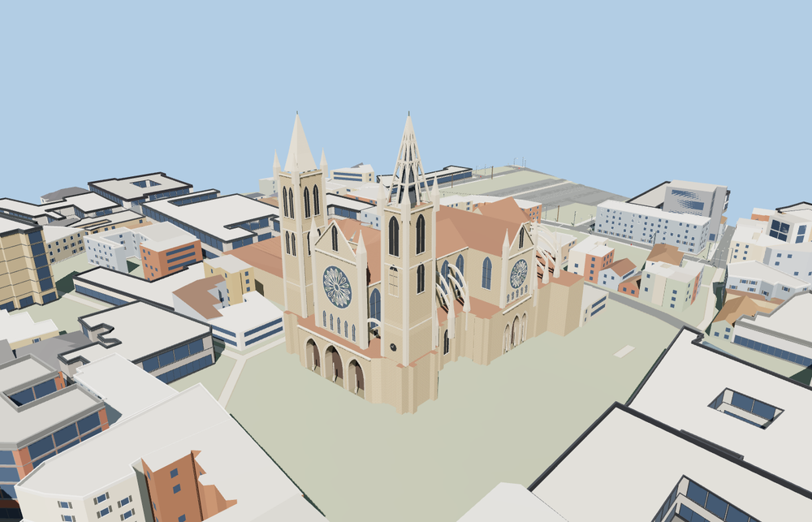

# León Cathedral

León Cathedral with the asymmetric west towers, three rose windows, deep pointed porches, flying buttresses, radial chapels and the attached open cloister.

The 25,378-triangle source rebuilds byte for byte. Skyline, district, street and close-up use 953, 2,954, 15,826, 22,846 triangles. The first two tiers total 333,456 bytes. Six GLBs validated and 38 current views were inspected.

Every tier passes six entrance recess and threshold checks, four buttress clearance checks, two tower probes, and eight open-court probes. Foundation probes hit 21 contacts in the detailed tiers. The viewer retains 256 neighboring buildings, 63 mapped road parts and the original terrain. Failed loading restores all five mapped cathedral and cloister features.

The exterior follows the PMTiles footprint and mapped height controls. Window, statue, vault and stonework details are reconstructed from ordinary photographs at world-viewer scale. The cloister galleries and exterior wings are present and the court is open. Interior spaces, stained-glass iconography and current visitor access are outside this model. Physical-device timings are unmeasured.

Rebuild with `node packages/worldgen/scripts/generate-leon-cathedral.mjs`. Append `--check` to compare exact bytes. Use `--ids=leon_cathedral` for targeted import, LOD, placement and readiness.
