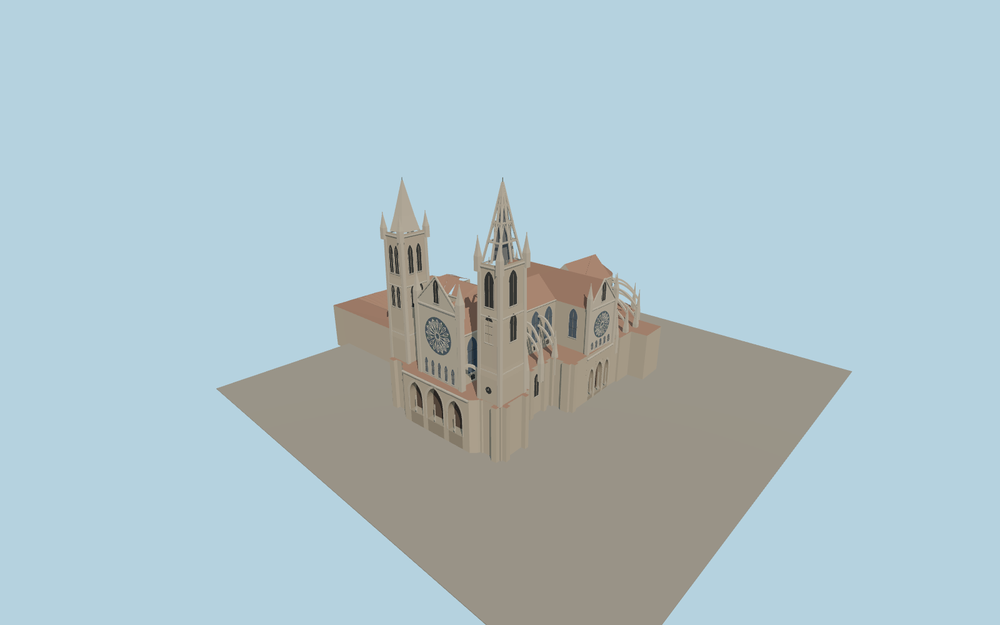

# León Cathedral

León Cathedral with the asymmetric west towers, three rose windows, deep pointed porches, flying buttresses, radial chapels and the attached open cloister.

Run `node packages/worldgen/scripts/generate-leon-cathedral.mjs` to rebuild the source master. Append `--check` to compare the exact bytes. Use `--ids=leon_cathedral` for targeted import, LOD generation and placement.

The exterior follows the PMTiles footprint and mapped height controls. Window, statue, vault and stonework details are reconstructed from ordinary photographs at world-viewer scale.

The cloister galleries and exterior wings are present and the court is open. Interior spaces, stained-glass iconography and current visitor access are outside this model.

Original geometry follows the repository license. Map data is © OpenStreetMap contributors under ODbL-1.0 via Protomaps. Terrain samples are described in terrain-grid.json. Ordinary pictures stay local and are not redistributed or used as textures. Current acceptance:qa.json.
