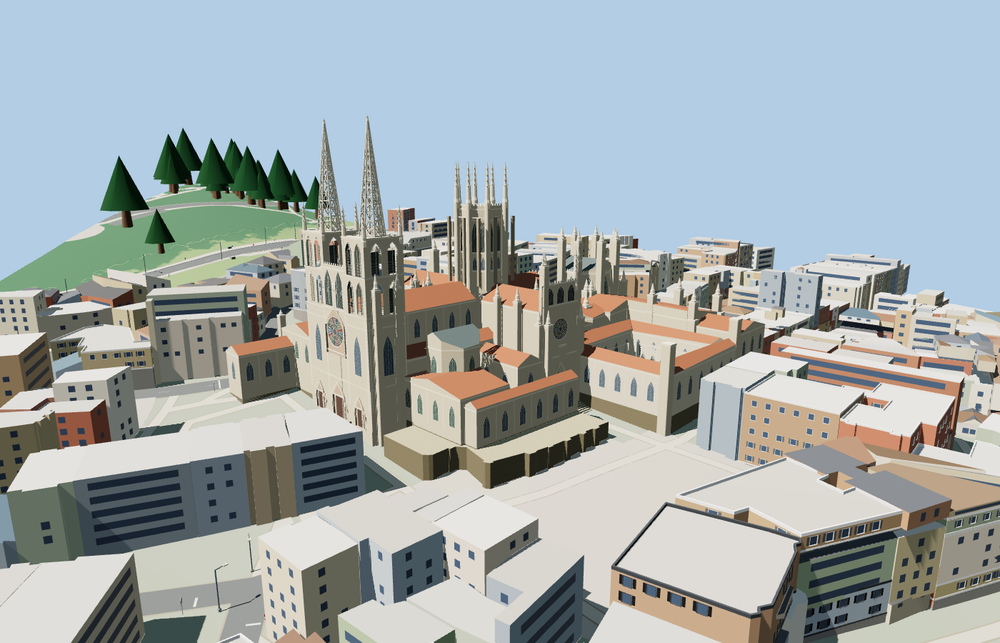

# Burgos Cathedral

Burgos Cathedral with its twin openwork spires, Santa María rose and portal, octagonal crossing lantern, Sarmental front, Constable Chapel, and open cloister.

The 47,614-triangle source rebuilds byte for byte. Skyline, district, street and close-up use 998, 3,598, 15,052, 46,706 triangles. The first two tiers total 391,312 bytes. Six GLBs validated and 38 current views were inspected.

Each tier preserves the open cloister and passes four courtyard, ten foundation, ten stair and seven roof probes. The west spires rise 75 m and the crossing pinnacles reach 65 m above the site datum. The viewer retains 763 independent building records and 310 mapped transportation parts. Failed loading restores the 181 native cathedral records.

The model uses the mapped cathedral and ordinary exterior photographs. Vertical profiles, tracery, sculptures and small masonry details are visual approximations. The cloister court remains open. The closed portals represent the exterior only, and surrounding plazas, the fountain and adjacent buildings remain in the host map. Physical-device timings are unmeasured.

Rebuild with `node packages/worldgen/scripts/generate-burgos-cathedral.mjs`. Append `--check` to compare exact bytes. Use `--ids=burgos_cathedral` for targeted import, LOD, placement and readiness.
