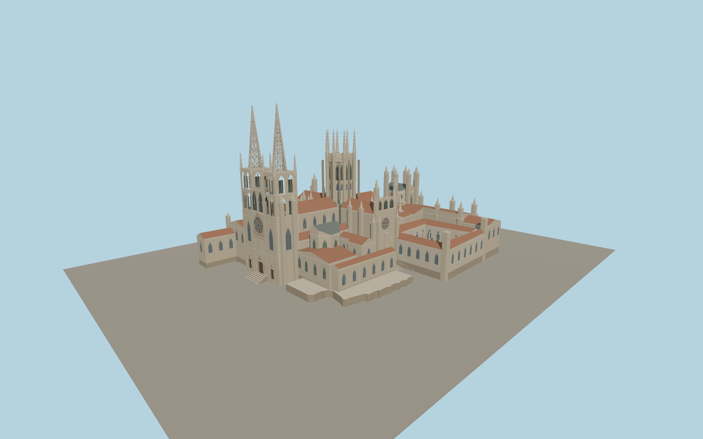

# Burgos Cathedral

Burgos Cathedral with its twin openwork spires, Santa María rose and portal, octagonal crossing lantern, Sarmental front, Constable Chapel, and open cloister.

Run `node packages/worldgen/scripts/generate-burgos-cathedral.mjs` to rebuild the source master. Append `--check` to compare the exact bytes. Use `--ids=burgos_cathedral` for targeted import, LOD generation and placement.

The model uses the mapped cathedral and ordinary exterior photographs. Vertical profiles, tracery, sculptures and small masonry details are visual approximations.

The cloister court remains open. The closed portals represent the exterior only, and surrounding plazas, the fountain and adjacent buildings remain in the host map.

Original geometry follows the repository license. Map data is © OpenStreetMap contributors under ODbL-1.0 via Protomaps. Terrain samples are described in terrain-grid.json. Ordinary pictures stay local and are not redistributed or used as textures. Current acceptance is recorded in qa.json.
